<div align="center">

[`EN` English](README.md) · [`PT` Português (BR)](README.pt-BR.md) · `ES` **Español**

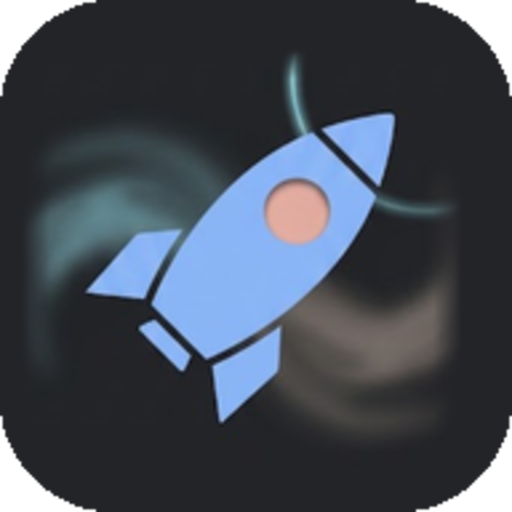

# 🚀 Lightspeed

**Un metalauncher, capa de control de Android y estación de trabajo.**


</div>

> **La base de Android es Linux.**  
> Cambiar entre dispositivos o de equipo Android no debería significar perder capacidades por reglas o restricciones artificiales impuestas por la capa de software que se construye encima.
>
> Lightspeed busca recuperar el control y mejorar la forma en que interactúas con tu dispositivo, sin obligarte a elegir entre las implementaciones de Lightspeed y las propias de tu fabricante.
>
> El Comando Central de Lightspeed ofrece un portal pulido para configurar la navegación, la interacción con el hardware, las balizas de información y los controles integrados del sistema (los System Override), a la medida de ti y de tu Android.

<a id="download"></a>

<div align="center">

[](https://github.com/SBFlabs/Lightspeed/releases/latest)
[](https://apps.obtainium.imranr.dev/redirect?r=obtainium://app/%7B%22id%22%3A%22com.sbf.lightspeed%22%2C%22url%22%3A%22https%3A//github.com/SBFlabs/Lightspeed%22%2C%22author%22%3A%22SBF%20Labs%22%2C%22name%22%3A%22Lightspeed%22%2C%22additionalSettings%22%3A%22%7B%5C%22includePrereleases%5C%22%3A%20false%2C%20%5C%22fallbackToOlderReleases%5C%22%3A%20true%7D%22%7D)
[](https://www.youtube.com/@SBFlabs)
[](https://buymeacoffee.com/sbflabs/e/579114)

</div>

> [!TIP]
> **Descarga y verificación SHA-256:** Toca **Descargar APK** arriba para obtener la última versión de GitHub, o **Añadir a Obtainium** para importar Lightspeed ya configurado con las **versiones preliminares desactivadas** (solo versiones estables). Cada versión incluye una **suma de verificación SHA-256** oficial en sus notas de lanzamiento para la verificación criptográfica.

> **Otras tiendas:** También disponible en [**ShizuStore**](https://shizustore.com/apps/lightspeed) y [**Orion Store**](https://rookieenough.github.io/Orion-Data/redirect.html?id=lightspeed) *(el enlace de Orion se abre dentro de la app Orion Store, por lo que debe estar instalada)*.

<p align="center">
  <a href="#1-category-cruise">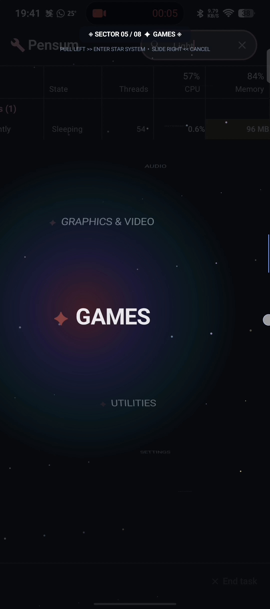</a>
  &nbsp;&nbsp;
  <a href="#2-cockpit">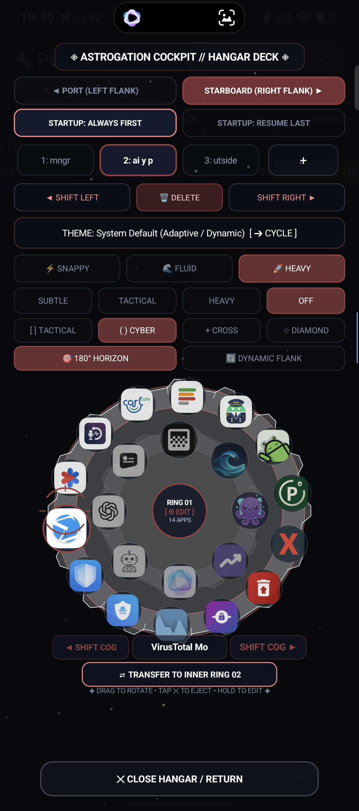</a>
  &nbsp;&nbsp;
  <a href="#3-central-command">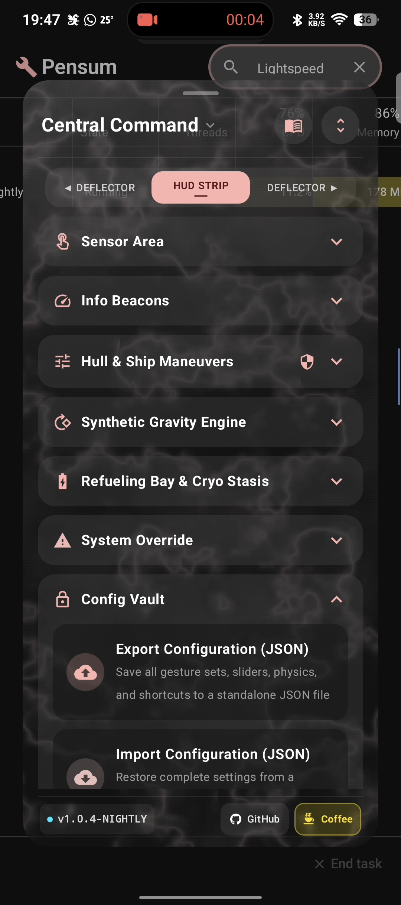</a>
</p>

<a id="index"></a>
<details>
<summary><strong>🧭 Tabla de contenidos (toca para expandir)</strong></summary>

- [📥 Descarga y verificación](#download)
- [🚀 Una plataforma de lanzamiento, tres estaciones de trabajo](#one-launch-pad-three-workstations)
  - [🛰️ La plataforma de lanzamiento](#the-launch-pad)
  - [1. 🌌 Category Cruise](#1-category-cruise)
  - [2. ⚙️ Cockpit](#2-cockpit)
  - [3. 🛰️ Comando Central](#3-central-command)
- [📡 Áreas de sensores de gestos (HUD STRIP y DEFLECTORES)](#gesture-sensor-areas)
  - [🪢 La Cuerda](#the-rope)
- [🌌 Aviónica de vuelo avanzada](#advanced-flight-avionics)
  - [1. Área de sensores](#1-sensor-area)
  - [2. Balizas de información](#2-info-beacons)
  - [3. Casco y maniobras de la nave](#3-hull-ship-maneuvers)
  - [4. Anulaciones del sistema](#4-system-overrides)
  - [5. Bóveda de Configuración](#5-config-vault)
  - [6. Laboratorios experimentales](#6-experimental-labs)
  - [7. Decks, trackpad, áreas de sensores y Master Cloak (v1.4.0)](#7-v140-highlights)
  - [8. 🆕 Idiomas, widgets HUD y pulido del día 1 (v1.4.1)](#8-v141-highlights)
- [🔐 Permisos y capacidades elevadas](#permissions-elevated-capabilities)
- [⚡ Automatización externa](#external-automation)
- [🆘 Si tu teléfono queda en mal estado](#bad-state-recovery)
- [🛠️ Arquitectura y aviso sobre desarrollo con IA](#architecture-ai-notice)
- [💬 Comunidad, incidencias y política de soporte](#community-support-policy)
- [💙 Modelo gratuito y de longevidad con apoyo de la comunidad](#free-supporter-model)
- [📄 Licencia y créditos](#license-credits)

</details>

---

<a id="one-launch-pad-three-workstations"></a>
# 🚀 Una plataforma de lanzamiento, tres estaciones de trabajo

<sup><a href="#index">[↑ Volver al índice]</a></sup>

<a id="the-launch-pad"></a>
## 🛰️ La plataforma de lanzamiento

<sup><a href="#index">[↑ Volver al índice]</a></sup>

La **Astrogación Central**, o simplemente la barra lateral, es tu puerta de entrada a las tres áreas principales de Lightspeed.

<a id="1-category-cruise"></a>
### 1. 🌌 Category Cruise

<sup><a href="#index">[↑ Volver al índice]</a></sup>

El cajón de apps organizado por categorías.

Para explorar las categorías, desliza el dedo hacia arriba y hacia abajo por la **Astrogación Central**. Para explorar una categoría específica, desliza horizontalmente mientras esa categoría está en foco, sin levantar el dedo.

Tu posición dentro del **Category Cruise**, o el elemento enfocado dentro de la categoría elegida, se calcula en relación con la ubicación de tu dedo según las dimensiones de tu pantalla. Sin importar desde dónde planees hacer el salto o a dónde regreses en el **Category Cruise**, siempre te resultará fácil recorrer todo el cajón de apps con el pulgar sin levantarlo.

Para cancelar el gesto en cualquier momento, desliza el dedo de regreso a la **Astrogación Central** o al borde de la pantalla.

En la parte superior de Category Cruise hay un **HUD Deck** personalizable (hasta 3 espacios en fila o en pila deslizable) con el **Inspector de la app en foco**, **Tiempo de pantalla y línea de tiempo horaria de 24 h**, **Signos vitales del sistema y Cazador de tareas** (subvistas `BATTERY`, `SYSTEM`, `VITALS` y `CHART`, con un administrador de tareas de CPU/wakelocks integrado `[HUNT ▸]` e historial de `1H` a `30D`), **Alertas y Firewall de notificaciones emergentes** y un **espacio para widgets de apps de Android** interactivo. Desde la v1.4.1, los widgets HUD también incluyen **indicadores de progreso del tiempo de pantalla** (con una lista de **Apps ignoradas**) y una cuenta regresiva del **Próximo evento del calendario**, estrictamente opcional y 100% offline.

<br>

<p align="center">
  
</p>

<p align="center"><sub>🌠 <em>Category Cruise — navegación cinética de apps con cuadrícula de íconos en vivo</em></sub></p>

<br>

<p align="center">
  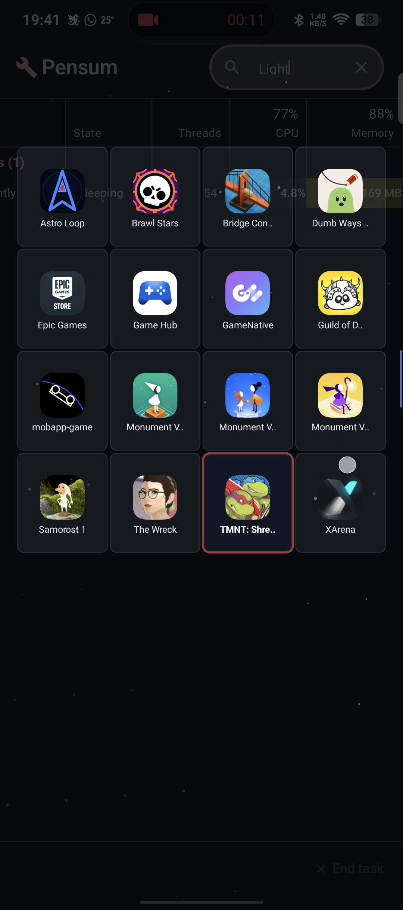
</p>

<p align="center"><sub>🌠 <em>Category Cruise — navegación en el 2.º salto</em></sub></p>

<br>

<p align="center">
  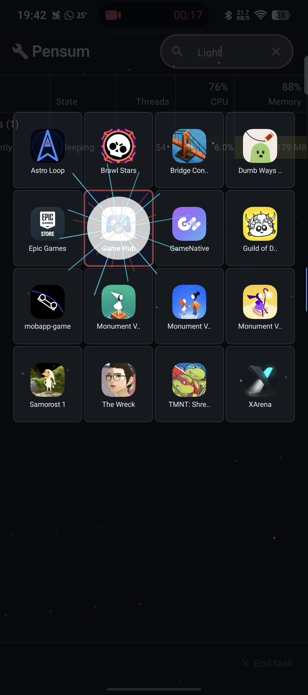
</p>

<p align="center"><sub>🌠 <em>Category Cruise — abriendo una app</em></sub></p>

<a id="2-cockpit"></a>
### 2. ⚙️ Cockpit

<sup><a href="#index">[↑ Volver al índice]</a></sup>

Un espacio de trabajo configurable construido en torno a los **Conjuntos de engranajes del Cockpit** y el **Menú de selección de acciones**.

Cada Conjunto de engranajes contiene dos engranajes con un **Hangar del Cockpit** giratorio en el centro, representado por una retícula que gira. Una retícula fija separada permanece sin rotar, anclada al elemento actualmente enfocado.

El **Menú de selección de acciones** es la interfaz global de Lightspeed para elegir a qué se asignan los gestos, las maniobras de hardware o los elementos de un Conjunto de engranajes.

En la parte superior hay un acordeón dedicado a las **Acciones del sistema**, que incluye acciones que usan Shizuku, como cerrar una app de forma ordenada y cambiar a la app anterior. También ofrece accesos directos al **Vigía del Perímetro** y al **Vigía del Núcleo**.

Debajo, las apps de uso frecuente se pueden fijar arriba para un acceso más rápido. Por ejemplo, **MacroDroid, Tasker, Key Mapper y Shortcut Maker** están fijadas de forma predeterminada si están instaladas. Cualquier acordeón de app se puede fijar o desfijar con una pulsación larga.

Para cada app, Lightspeed intenta ofrecer sus accesos directos de app disponibles, los accesos directos del launcher de la pantalla de inicio y sus actividades profundas. Una app se puede abrir directamente tocando el título o el ícono de su acordeón, o bien se puede expandir el acordeón para elegir entre las opciones mencionadas.

El Menú de selección de acciones también incluye la propuesta distintiva de Lightspeed de una barra de desplazamiento indexada. Se puede usar tocando el índice o deslizando el dedo sobre él. Mientras interactúas con la barra de índice, un HUD muestra las dos primeras letras correspondientes a la posición alfabética actual, para que siempre sepas dónde estás dentro de la lista de apps.

<br>

<p align="center">
  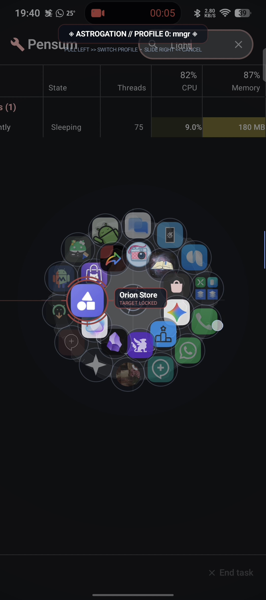
</p>

<p align="center"><sub>⚙️ <em>Conjuntos de engranajes del Cockpit (elementos favoritos)</em></sub></p>

<br>

<p align="center">
  
</p>

<p align="center"><sub>⚙️ <em>Hangar del Cockpit — dos anillos de engranajes orbitales con controles táctiles completos para expulsar, rotar y editar</em></sub></p>

<br>

<p align="center">
  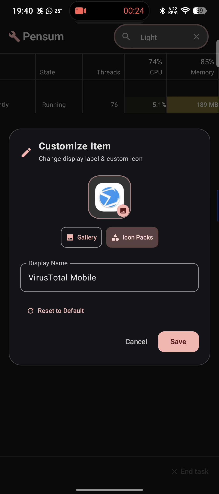
</p>

<p align="center"><sub>⚙️ <em>Hangar del Cockpit — edición de elementos del hangar</em></sub></p>

<a id="3-central-command"></a>
### 3. 🛰️ Comando Central

<sup><a href="#index">[↑ Volver al índice]</a></sup>

Se puede acceder al Comando Central directamente tocando el **ícono de la app Lightspeed**, o desde la **Astrogación Central**. Mientras recorres las categorías deslizando hacia abajo por la Astrogación Central, el Comando Central permanece oculto detrás de la última categoría. Desliza un poco más hacia abajo para revelarlo, acompañado de una sutil **señal háptica**.

<br>

<p align="center">
  
</p>

<p align="center"><sub>🛰️ <em>Comando Central — HUD Strip, área de sensores, casco y maniobras de la nave, System Override y Bóveda de Configuración</em></sub></p>

<br>

<p align="center">
  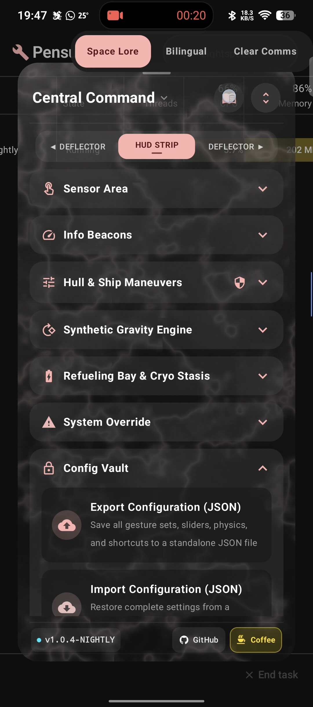
</p>

<p align="center"><sub>🛰️ <em>Comando Central — ajustes de idioma</em></sub></p>

El **área del encabezado de la ventana flotante del Comando Central** es interactiva de tres maneras. Puedes deslizar hacia abajo sobre el encabezado para cerrar la ventana flotante. El **título del Comando Central** admite un toque simple o largo: un toque largo activa o desactiva rápidamente todo el sistema Lightspeed. El **ícono de la Guía** también admite un toque simple o largo. Además, está el clásico botón **Expandir/Contraer todo** para expandir o contraer los acordeones de la pestaña actual.

Para personalizar el **tema del Comando Central**, toca el título del Comando Central. Para organizar o cambiar la disposición de los acordeones dentro de una pestaña específica, toca el **título de la pestaña mientras está en foco**, ya sea **HUD STRIP, DEFLECTOR izquierdo o DEFLECTOR derecho**.

El **Deck de control de vuelo** está organizado en tres tarjetas. La primera contiene el **motor de temas** mencionado para el Comando Central y distintas formas de activar o desactivar Lightspeed en su totalidad o en parte.

<br>

<p align="center">
  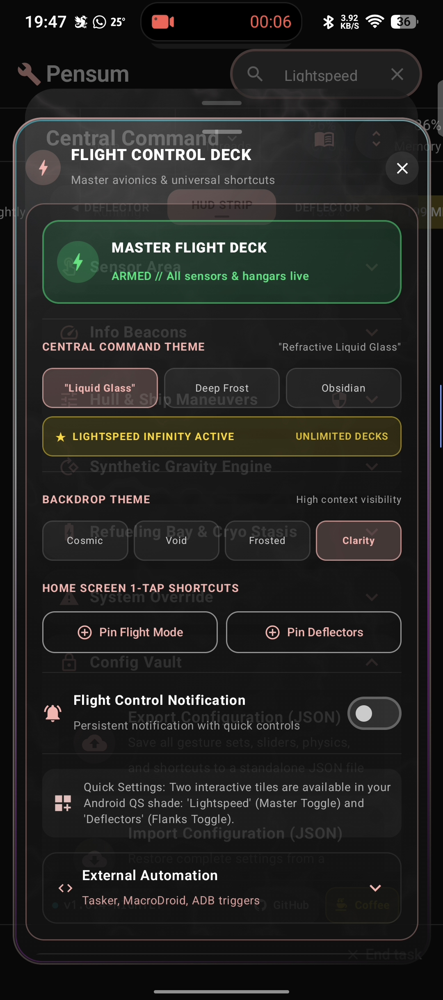
</p>

<p align="center"><sub>🛰️ <em>Deck de control de vuelo — vista general</em></sub></p>

<br>

<p align="center">
  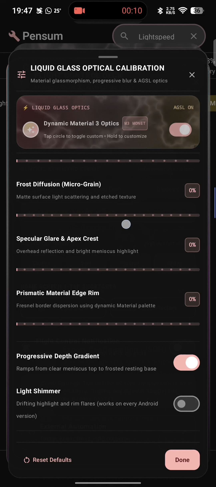
</p>

<p align="center"><sub>🛰️ <em>Deck de control de vuelo — selección de tema</em></sub></p>

La segunda tarjeta contiene el **Vigía del Núcleo**. Mantiene Lightspeed activo mediante dos métodos posibles e incluye la **Caja Negra**:

1. **Auto-reactivación** — cuando Lightspeed falla, activa un mensaje de reactivación automática usando Shizuku. **Activada de forma predeterminada.**
2. **Verificación periódica** — cada 20 segundos, comprueba si Lightspeed sigue activo y operativo.
3. **Caja Negra** — guarda un registro ligero del último fallo o error de acción de Lightspeed, que se puede copiar y pegar en incidencias de GitHub para facilitar el diagnóstico.

El **Vigía del Núcleo** también contiene una **minitarjeta/botón de Material 3 llamado “Servicios”.** Al presionarlo se abre el **Vigía del Perímetro**, donde los servicios de accesibilidad de tus apps se pueden activar o desactivar con más comodidad que desde la página de ajustes integrada de Android. Cada servicio también se puede **blindar** y tener su exención de batería permitida o revocada mediante dos botones dedicados justo debajo.

<br>

<p align="center">
  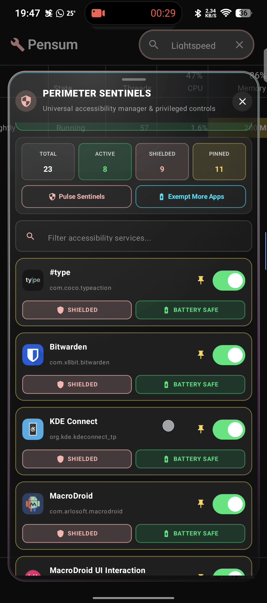
</p>

<p align="center"><sub>🛰️ <em>Vigía del Perímetro — monitoreo de servicios de accesibilidad</em></sub></p>

El **Vigía del Perímetro** también contiene una **minitarjeta/botón azul claro de Material 3 llamado “Eximir más apps”.** Al presionarlo se abre la **ventana flotante Eximir más apps**, que ofrece una forma más accesible de permitir o revocar apps en el sistema nativo de exención de administración de batería de Android.

<br>

<p align="center">
  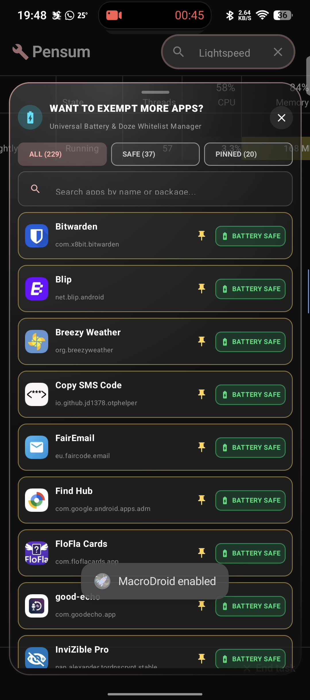
</p>

<p align="center"><sub>🛰️ <em>Eximir más apps — control de exención de batería</em></sub></p>

**Ni el Vigía del Núcleo ni el Vigía del Perímetro son 100% infalibles, y deben tratarse como tales.**

También hay **Acciones del sistema** dedicadas para abrir directamente la ventana del **Vigía del Perímetro** y la tarjeta del **Vigía del Núcleo**. De forma predeterminada, se asignan a los **deslizamientos izquierdo y derecho del área de sensores del HUD STRIP**, respectivamente, para ofrecer acceso rápido sin tener que navegar por el Comando Central.

La **tercera tarjeta** ofrece otra forma de activar o desactivar Lightspeed en su totalidad o en parte.

---

<a id="gesture-sensor-areas"></a>
## 📡 Áreas de sensores de gestos (HUD STRIP y DEFLECTORES)

<sup><a href="#index">[↑ Volver al índice]</a></sup>

La pestaña **HUD STRIP** contiene el acordeón **Área de sensores** para el área de gestos de la barra de estado. Las pestañas **DEFLECTOR izquierdo** y **DEFLECTOR derecho** contienen los ajustes de los bordes izquierdo y derecho de tu pantalla, respectivamente. Son áreas de sensores para los gestos que realizas a lo largo de los bordes de la pantalla.

Aquí hay mucha personalización y bastante por explorar, sobre todo con el **Menú de selección de acciones**.

<a id="the-rope"></a>
### 🪢 La Cuerda

<sup><a href="#index">[↑ Volver al índice]</a></sup>

Cada DEFLECTOR tiene un acordeón de **Deflectores unificados**, que refleja cómo cada lado de la pantalla puede tratarse como una sola área de gestos unificada o como dos controles separados.

Dentro de él, la **Matriz de gestos unificada** contiene una entrada por cada gesto. Cada entrada de gesto tiene su propia **Cuerda**. Cuando la Cuerda está atada, ese gesto se configura como un único control en las partes superior e inferior del DEFLECTOR.

Toca la Cuerda para desatarla. La entrada del gesto se duplica entonces en entradas de gesto **superior** e **inferior** separadas, que pasan al subacordeón **Controles separados del DEFLECTOR**. Desde ahí, cada mitad se puede configurar de forma independiente; por ejemplo, usar el gesto de **tocar y mantener** de la mitad superior para controlar el brillo y el de la inferior para controlar el volumen.

Al mantener presionada la Cuerda, se envía la asignación de gesto actual al DEFLECTOR opuesto. Es simplemente una operación de copiar y pegar una sola vez, no un espejo ni una sincronización persistente.

---

<a id="advanced-flight-avionics"></a>
## 🌌 Aviónica de vuelo avanzada

<sup><a href="#index">[↑ Volver al índice]</a></sup>

El **HUD STRIP** incluye un conjunto de acordeones configurables con controles de vuelo adicionales, información y herramientas del sistema. Su disposición predeterminada es:

<a id="1-sensor-area"></a>
### 1. Área de sensores

<sup><a href="#index">[↑ Volver al índice]</a></sup>

El **Área de sensores** es el área de gestos de la barra de estado descrita arriba. Sus gestos son totalmente personalizables mediante el **Menú de selección de acciones**.

<a id="2-info-beacons"></a>
### 2. Balizas de información

<sup><a href="#index">[↑ Volver al índice]</a></sup>

Las **Balizas de información** te permiten enviar la telemetría al **Riel del Horizonte**, a la **Cápsula Orbital**, o a ambos.

El **Riel del Horizonte** es una línea de progreso para descargas y para el contenido multimedia en reproducción. Muestra dos líneas de forma predeterminada y se puede configurar de una a tres líneas. También puede mostrar el nombre del contenido que se está reproduciendo, lo cual resulta especialmente útil en tabletas y otras pantallas grandes donde el centro de la barra de estado ofrece espacio adicional. **El Riel del Horizonte está desactivado de forma predeterminada.**

La **Cápsula Orbital** es una implementación ligera de una cápsula interactiva alrededor del orificio de la cámara. Ofrece varias funciones interactivas, pero su desarrollo se ha despriorizado deliberadamente, ya que muchos dispositivos Android ahora incluyen sus propias implementaciones. Sigue disponible para experimentar y podría recibir más desarrollo en el futuro. **La Cápsula Orbital está desactivada de forma predeterminada y sus propios ajustes están en Laboratorios experimentales.**

<a id="3-hull-ship-maneuvers"></a>
### 3. Casco y maniobras de la nave

<sup><a href="#index">[↑ Volver al índice]</a></sup>

**Casco y maniobras de la nave** ofrece las asignaciones de la **Matriz de teclas de volumen** y de los **Sensores de toque en el casco** (toque trasero).

También incluye salvaguardas para preservar las funciones nativas de Android de los botones de volumen y encendido, incluidos los gestos específicos de cada fabricante, como las capturas de pantalla y los accesos directos de los servicios de accesibilidad. Estos comportamientos varían entre fabricantes y capas de personalización de Android; por ejemplo, Samsung e Infinix XOS implementan sus accesos directos de accesibilidad de manera distinta.

**Consumo de batería del toque trasero:** el toque trasero solo mantiene un wake lock de CPU cuando su alcance está en *Pantalla apagada* o *Siempre* (ambos marcados como Alto consumo). Con *Solo con pantalla encendida* (el valor predeterminado) no se usa ningún wake lock. El wake lock tiene un límite de tiempo de seguridad y se desactiva automáticamente al 20% de batería o en el ahorro de batería.

<a id="4-system-overrides"></a>
### 4. Anulaciones del sistema

<sup><a href="#index">[↑ Volver al índice]</a></sup>

**Anulaciones del sistema** contiene la **Soberanía de gestos de borde nativos**, que puede neutralizar los gestos de borde nativos de Android para que los **DEFLECTORES** tengan control total sobre esas áreas de gestos.

También ofrece controles para la **Velocidad de animación**, las **Métricas de pantalla (DPI)** y la **Escala de fuente**. Estos tres controles deslizantes requieren Shizuku. Sin él están desactivados y Lightspeed muestra un aviso de "Shizuku sin conexión".

Como se trata de ajustes nativos del sistema Android comúnmente asociados con las Opciones de desarrollador, Lightspeed trata sus controles deslizantes con cautela. Tocar directamente la pista del control para saltar a un valor está desactivado de forma predeterminada. Mantén presionado el cuadro de valor para revelar la miniventana **Control de precisión y preajustes**, que contiene el interruptor **Tocar para saltar en la pista**. Luego puedes activarlo cuando quieras.

Los controles deslizantes también admiten ajuste fino. Mover el dedo por el control normalmente sigue los pasos predeterminados, más amplios. Mover el dedo verticalmente mientras se desliza en horizontal hace el ajuste más fino.

Tocar el cuadro de valor restablece ese ajuste a su valor predeterminado.

<a id="5-config-vault"></a>
### 5. Bóveda de Configuración

<sup><a href="#index">[↑ Volver al índice]</a></sup>

La **Bóveda de Configuración** contiene los controles de respaldo, exportación y restablecimiento de fábrica de Lightspeed, lo que permite conservar, exportar o restaurar la configuración a sus valores predeterminados.

<a id="6-experimental-labs"></a>
### 6. Laboratorios experimentales

<sup><a href="#index">[↑ Volver al índice]</a></sup>

Los **Laboratorios experimentales** contienen funciones que están **desactivadas de forma predeterminada** y que deben usarse bajo el propio criterio del usuario.

Esto incluye funciones experimentales como las **Vistas previas de automatización del Trackpad cibernético**, la **Cápsula Orbital**, la **Reasignación del botón de encendido** y el **Horario de enfriamiento del núcleo**. (**Sonic Deck**, **Vista Deck** y **Esclusa de astrogación** se graduaron a acordeones propios en la pestaña **HUD Strip**.)

La **Bahía de recarga** es una pantalla funcional de base de carga diseñada para mostrar la velocidad de carga y, a la vez, darte un espacio dedicado para tus widgets favoritos. También muestra el reloj y admite dos orientaciones de widgets, cada una con su propia disposición. Puede ser especialmente útil como pantalla de carga que se abre manualmente; por ejemplo, para mostrar la velocidad de carga junto con un calendario y widgets de tareas.

Como la Bahía de recarga actualmente oscurece la pantalla con una capa oscura en lugar de apagarla físicamente tras un tiempo de espera, **no se recomienda para pantallas OLED**. Por eso se mantiene en Laboratorios experimentales. Si quieres usarla, ábrela manualmente o asígnale un gesto mediante el **Menú de selección de acciones → Acciones del sistema → Mantenimiento de la nave**.

La **Reasignación del botón de encendido** ejecuta la acción asignada sin intentar bloquear el comportamiento nativo del botón de encendido del dispositivo.

Las demás funciones experimentales están sin terminar o actualmente no funcionan, y conviene tratarlas como tales.

Las funciones experimentales deben tratarse exactamente como eso: experimentos. El **gesto de deslizar hacia abajo del HUD STRIP** puede requerir aumentar el grosor del Área de sensores y mantener la distancia del deslizamiento hacia abajo aproximadamente igual a su grosor, para que no se active sin querer el gesto nativo de Android de desplegar la barra de estado.

<a id="7-v140-highlights"></a>
### 7. Decks, trackpad, áreas de sensores y Master Cloak (v1.4.0)

<sup><a href="#index">[↑ Volver al índice]</a></sup>

- **Motor de color de 3 vías (`12-Theme`, `Material 3`, `Hybrid`)**: Elige entre los modos de color 12-Theme, Material 3 (fondo de pantalla dinámico) e Hybrid de forma independiente en Category Cruise (en la pestaña de edición del HUD), los Conjuntos de engranajes del Cockpit, el Trackpad cibernético y cursor, y cada HUD de Scrubber (Brillo, Volumen, Tiempo de espera de pantalla, Búsqueda multimedia, Desplazamiento), con un modo universal de bloqueo **Mantener para aplicar a todo** (`HOLD ↗`).
- **HUD Deck de Category Cruise y Cazador de tareas de signos vitales**: HUD Deck modular de 3 espacios (`Inspector de la app en foco`, `Tiempo de pantalla y línea de tiempo horaria de 24 h`, `Signos vitales del sistema` con subvistas `BATTERY` / `SYSTEM` / `VITALS` / `CHART`, `Alertas y Firewall de notificaciones emergentes` y `Espacio para widget de app`) con un **Cazador de tareas de signos vitales** (`[HUNT ▸]`) integrado para inspeccionar y forzar la detención de los responsables en segundo plano del consumo de CPU/wakelocks, separación entre RAM residente y zRAM Swap fría, y gráficas de historial de `1H` a `30D`.
- **18 estilos de HUD de Scrubber y HUD de firma de acción**: Selector de estilos de HUD por categorías (`HUD de firma de acción`, `HUD Alpha-Shade`, `HUD minimalistas modernos`, `HUD orbitales circulares`, `HUD rectangulares y de barra`, además de la `Tarjeta interactiva de Scrubber de línea de tiempo`) con vista previa en vivo al mantener presionado (`HOLD ↗`) y desenfoque de captura de pantalla de hardware 1:1.
- **Trackpad cibernético**: Navegación con cursor flotante con aceleración y háptica personalizables, botones de macros de brazo robótico y geometría de chasis pulida (incluido el estilo **Glass**). Los modos de repetición de macros (`1x`, `2x`, `5x`, `∞ Loop`) en el Editor de macros del bot están completamente desbloqueados para todos los usuarios, con traspaso fluido del cursor entre ambos flancos y cancelación de emergencia con cualquier tecla de hardware.
- **Mosaico de Ajustes rápidos Master Cloak**: El único mosaico de Ajustes rápidos de Lightspeed. Tócalo para camuflar o rearmar todo; mantenlo presionado para elegir otros servicios de accesibilidad que se apagarán junto con él. La lista ampliada de 8 elementos permite detener/reiniciar `Shizuku-Next` y `Shevery` (con compatibilidad con token de autenticación), pausar el Watchdog de Shizuku-Next, suspender el loopback de audio de Sonic Deck y, opcionalmente, restablecer la Frecuencia de actualización Overdrive mientras está camuflado, para un sigilo sin conflictos con las apps bancarias.
- **Vista Deck**: Brillo, óptica de pantalla y telemetría de hardware unificados en un modal de 3 acordeones (`Brillo y más allá`, `Óptica y cuidado visual`, y `Hz Overdrive y HUD de telemetría`), junto al acordeón independiente **Esclusa de astrogación** en el HUD Strip. Incluye selección de frecuencia de actualización adaptada al hardware (`Adaptive`, con piso liberado hasta 10–24 Hz en video, frente a `Locked` con Hz máximo, además de la liberación de 144 Hz de Transsion/XOS) y un micro-visor `FPS · CPU · TEMP · RAM · BAT · WATT` arrastrable por app. Integrado en el Dominio de comando 13-Theme con reordenamiento interactivo mediante esquema Blueprint.
- **Deck Sónico**: Mezclador de volumen por app, enrutamiento de hardware multicanal y aislamiento de voz neuronal a 48 kHz con atenuador de fondo (`libsonicdsp.so`), con modos `MAX`, `Custom` y perfiles guardados por el usuario. Integrado en el Dominio de comando 13-Theme con reordenamiento interactivo mediante esquema Blueprint.
- **Área de sensores inferior**: Zona secundaria de gestos de borde reflejada en el borde inferior, con tamaño, grosor, desplazamiento y sensibilidad configurables, brillo de espera sigiloso y matriz completa de acciones de gestos.
- **Circle to Search / Screen Assist**: Asignación directa de gestos para activar Circle to Search de Google o tu herramienta predeterminada de Asistente / contexto de pantalla.
- **Esclusa de astrogación y selectores de apps objetivo**: La pausa consciente de 5 segundos muestra tanto el Tiempo de la app como el Tiempo del sector (tiempo total de hoy en la categoría de esa app), y ambos selectores de apps objetivo incluyen un acordeón de resumen plegable superior `▸ SELECTED APPS (N)` y un riel interactivo de desplazamiento rápido por alfabeto `A–Z`.

<a id="8-v141-highlights"></a>
### 8. 🆕 Idiomas, widgets HUD y pulido del día 1 (v1.4.1)

<sup><a href="#index">[↑ Volver al índice]</a></sup>

- **Multiidioma (`EN`, `PT-BR`, `ES`, `AR`) y RTL desacoplado**: Lightspeed se entrega en inglés, portugués de Brasil, español latinoamericano neutro y árabe estándar moderno, además de un interruptor independiente de **Diseño RTL / para zurdos** (`pref_ui_rtl_layout_enabled`) que invierte los paneles manteniendo las áreas de gestos en sus bordes físicos. El cambio es 100% offline e instantáneo: sin reiniciar y sin descargas.
- **Modo bilingüe del mundo real**: Elige un idioma principal y uno secundario, y Lightspeed muestra ambos en los títulos principales, los encabezados de acordeón y los encabezados de sección (nunca en botones compactos, chips ni controles deslizantes). Se combina con los modos de vocabulario, incluido un emparejamiento de vocabulario distintivo **Lore + Simple** (términos del lore espacial con aclaración en lenguaje simple).
- **Selector de guía de 2 ejes**: Mantén presionado el **ícono de la Guía** y luego desliza **horizontalmente** para el modo de vocabulario o **verticalmente** para el idioma del mundo real (Bilingüe, `EN`, `PT`, `ES`, `AR`). Los idiomas se muestran como insignias de código neutras, sin banderas. Un control deslizante de idioma equivalente y un editor del par Principal / Secundario están en la parte superior de la Guía.
- **Widgets HUD de Category Cruise**: Indicadores de progreso de **Tiempo de pantalla** con una lista de **Apps ignoradas**, **Batería y sistema**, **Privacidad** y un espacio interactivo para widgets de apps. La cuenta regresiva del **Próximo evento del calendario** es estrictamente opcional y 100% offline: lee el calendario de tu dispositivo solo después de que concedas `READ_CALENDAR`, y puedes elegir Todos, Trabajo, Personal o calendarios individuales.
- **Explicaciones de signos vitales del sistema / Cazador de culpables**: Las explicaciones integradas te ayudan a interpretar las vistas `BATTERY`, `SYSTEM`, `VITALS` y `CHART` y a usar `[HUNT ▸]` para encontrar a los responsables de CPU/wakelocks que drenan tu batería.
- **Experiencia pulida desde el día 1**: Controles Material 3, valores predeterminados de desenfoque Hybrid, **HUD de firma** como estilo predeterminado en cada scrubber (Volumen, Brillo, Tiempo de espera de pantalla, Multimedia, Desplazamiento) y una configuración más limpia de dos tarjetas de **Armar el Núcleo de Lightspeed**, con la ayuda adicional integrada en filas expandibles compactas. Las instalaciones existentes nunca se modifican con los nuevos valores predeterminados.

---

<a id="permissions-elevated-capabilities"></a>
## 🔐 Permisos y capacidades elevadas

<sup><a href="#index">[↑ Volver al índice]</a></sup>

Lightspeed está diseñado para funcionar como un **launcher de gestos y espacio de trabajo con overlays completo y de primera clase usando únicamente el Servicio de accesibilidad de Android** (junto con permisos estándar concedidos por el usuario, como **Modificar ajustes del sistema**). La navegación principal, **Category Cruise**, los **Conjuntos de engranajes del Cockpit**, el **HUD Strip**, los **Deflectores**, el **Trackpad cibernético y las macros de bot**, el **Vista Deck** (brillo, atenuación extra, píxeles inteligentes, frecuencia de actualización de pantalla y HUD de telemetría por app), la **Esclusa de astrogación** y los **Space Pods** funcionan sin Shizuku.

Para quienes desean una integración más profunda a nivel de sistema operativo, **Shizuku** actúa como un multiplicador opcional para usuarios avanzados, y muchos interruptores del sistema (como **Master Cloak**, **Cuidado visual**, **Supresión del gesto de retroceso en el borde** y **Giro automático por rostro**) también funcionan de forma permanente sin que Shizuku esté en ejecución si `WRITE_SECURE_SETTINGS` se concede una vez mediante ADB o Shizuku.

### Servicio de accesibilidad

El Servicio de accesibilidad es la base de la arquitectura de gestos y overlays de Lightspeed. Permite a Lightspeed detectar gestos en toda la pantalla, ejecutar acciones de navegación globales (**Atrás, Inicio, Recientes, Notificaciones, Ajustes rápidos, Pantalla dividida, Capturas de pantalla, Bloqueo de pantalla**), renderizar espacios de trabajo con overlay de latencia cero (**Category Cruise, Cockpit, Vista Deck, HUD de telemetría, Trackpad cibernético**) y mantener la capacidad de respuesta de los gestos mientras otras aplicaciones están en primer plano.

### Shizuku (multiplicador opcional para usuarios avanzados)

**Shizuku** es opcional pero recomendado para quienes quieren capacidades elevadas del shell de Android sin root.

Cuando está activo, Shizuku desbloquea funciones adicionales a nivel de sistema:

- **Cambio a la app anterior** — Cambia directamente entre aplicaciones recientes sin pasar por el **menú de apps recientes** del launcher.
- **Cierre ordenado de tareas** — Cierra la aplicación activa mediante un mecanismo de eliminación ordenada de la tarea, en lugar de depender del gesto de apps recientes del fabricante. Esta distinción importa en sistemas Android muy personalizados, donde deslizar una aplicación fuera del menú de apps recientes puede interpretarse como una **detención forzada**. El Cierre ordenado de tareas busca evitar ese comportamiento en la medida de lo posible, lo que puede ser especialmente útil para aplicaciones como Termux, que de otro modo podrían verse afectadas por una administración agresiva de tareas del fabricante. La implementación todavía **no es 100% infalible frente a la eliminación de tareas por parte del fabricante ni otras formas de administración de procesos a nivel de sistema**.
- **Pantalla dividida y ventanas emergentes** — Abre aplicaciones compatibles en pantalla dividida o en ventanas emergentes flotantes. Las funciones de pantalla dividida y ventanas emergentes se han probado en Infinix XOS 16 y el comportamiento puede variar según el dispositivo; las ventanas emergentes específicas de cada fabricante no son compatibles.
- **Incorporación inicial de Lightspeed** — Ayuda a habilitar el Servicio de accesibilidad de Lightspeed y a completar su configuración inicial sin que el usuario tenga que recorrer manualmente varias pantallas de ajustes de Android.
- **Descubrimiento de apps en el Menú de selección de acciones** — Las actividades profundas y las entradas de "crear acceso directo" se descubren sin Shizuku. Android normalmente solo expone los accesos directos del launcher de la pantalla de inicio y los accesos directos dinámicos de las apps al launcher predeterminado, así que Lightspeed primero consulta directamente a Android y usa Shizuku para cubrir lo que falta.

### Permisos concedidos por el usuario

La mayoría de los permisos de Lightspeed no requieren interacción adicional del usuario. Los permisos que sí requieren una acción del usuario están ligados principalmente a funciones específicas:

- **Modificar ajustes del sistema** — Necesario cuando usas Lightspeed para modificar ajustes como el **brillo de pantalla** o el **tiempo de espera de pantalla**.
- **Acceso a notificaciones** — Necesario al habilitar funciones de **Balizas de información** que dependen del acceso a las notificaciones, como la información de reproducción multimedia o de progreso de descargas.
- **Ignorar optimizaciones de batería** — Se usa para la administración de batería y la funcionalidad de vigía de Lightspeed donde sea compatible.
- **Publicar notificaciones** — Se usa para el estado y los controles basados en notificaciones, incluida la posibilidad de activar o desactivar los **DEFLECTORES** y Lightspeed en su totalidad.
- **Acceso de uso** — Necesario para los widgets HUD de **Tiempo de pantalla** y para el Tiempo de la app / Tiempo del sector de la Esclusa de astrogación.
- **Calendario (`READ_CALENDAR`)** — **Estrictamente opcional.** Solo se solicita si activas la cuenta regresiva del **Próximo evento del calendario**. Los eventos se leen localmente en tu dispositivo y nunca salen de él.
- **Llamar por teléfono** — Se solicita para llamar directamente a contactos mediante los accesos directos del launcher de la pantalla de inicio; si no se concede, Lightspeed marca a través del shell de Shizuku.

### Otros permisos

Lightspeed declara los siguientes permisos, pero no requieren un aviso de permiso separado concedido por el usuario según el manejo normal de permisos de Android:

- **Consultar todos los paquetes** — Permite a Lightspeed descubrir las aplicaciones instaladas para **Category Cruise**, el **Menú de selección de acciones** y funciones relacionadas de apertura de apps.
- **Vibrar** — Proporciona respuesta háptica en toda la interfaz.
- **Internet** — **No declarado.** Lightspeed no tiene el permiso `android.permission.INTERNET` y, por lo tanto, no tiene acceso a la red mediante las API de red estándar de Android.
- **Escribir ajustes seguros** — Se usa para el giro automático con la cámara. Es un permiso protegido, por lo que debe concederse mediante Shizuku o ADB.
- **Wake Lock** — Lo usa el toque trasero (solo en alcance Pantalla apagada o Siempre) y para activaciones breves de pantalla de 3 segundos por parte de la Reasignación del botón de encendido y la Bahía de recarga.

---

<a id="external-automation"></a>
## ⚡ Automatización externa

<sup><a href="#index">[↑ Volver al índice]</a></sup>

Lightspeed admite automatización externa mediante intents de broadcast (Tasker, MacroDroid y apps similares, mediante intents de broadcast).

### Ajuste opcional
La automatización externa está desactivada de forma predeterminada. Para permitir que apps externas y ADB envíen comandos, activa el interruptor:
- **Comando Central → Laboratorios experimentales → Permitir automatización externa (Tasker, MacroDroid, ADB)**

### Acciones de broadcast compatibles
- `com.sbf.lightspeed.action.TOGGLE_FLIGHT_MODE`
- `com.sbf.lightspeed.action.SET_FLIGHT_MODE`
- `com.sbf.lightspeed.action.TOGGLE_DEFLECTORS`
- `com.sbf.lightspeed.action.TOGGLE_LEFT_DEFLECTOR`
- `com.sbf.lightspeed.action.TOGGLE_RIGHT_DEFLECTOR`
- `com.sbf.lightspeed.action.SET_DEFLECTOR`
- `com.sbf.lightspeed.action.GRAVITY_OVERRIDE_360`
- `com.sbf.lightspeed.action.TOGGLE_AUTO_ROTATE`
- `com.sbf.lightspeed.action.RESET_GRAVITY`

---

<a id="bad-state-recovery"></a>
## 🆘 Si tu teléfono queda en mal estado

<sup><a href="#index">[↑ Volver al índice]</a></sup>

Ejecuta solo los comandos de los ajustes que cambiaste. Los de wm density y font_scale son la solución más común.

Estos comandos se pueden ejecutar desde una computadora con adb, o desde la terminal de Shizuku si la pantalla aún es utilizable.

Si Lightspeed falla o se desinstala mientras siguen vigentes anulaciones del sistema activas, usa el comando ADB correspondiente de abajo para devolver tu dispositivo Android a su funcionamiento predeterminado:

### Métricas de pantalla y visuales
- **Densidad de pantalla (DPI)**:
  ```bash
  adb shell wm density reset
  ```
- **Escala de fuente**:
  ```bash
  adb shell settings put system font_scale 1.0
  ```
- **Escalas de animación globales**:
  ```bash
  adb shell settings put global window_animation_scale 1.0
  adb shell settings put global transition_animation_scale 1.0
  adb shell settings put global animator_duration_scale 1.0
  ```
- **Apagado de pantalla por hardware (energía del panel)**:
  ```bash
  adb shell cmd display power-on 0
  ```
- **Overdrive de frecuencia de actualización y liberación de 144 Hz de Transsion**:
  ```bash
  adb shell settings delete system peak_refresh_rate
  adb shell settings delete system min_refresh_rate
  adb shell settings delete system user_refresh_rate
  adb shell settings put system tran_refresh_mode 0
  adb shell device_config delete display_manager peak_refresh_rate_default
  ```

### Gestos y latencia táctil de entrada
- **Control de la pulsación larga del botón de encendido**:
  ```bash
  adb shell settings delete global power_button_long_press
  ```
- **Márgenes del gesto de retroceso en el borde nativo**:
  ```bash
  adb shell settings put secure back_gesture_inset_scale_left 1.0
  adb shell settings put secure back_gesture_inset_scale_right 1.0
  ```
- **Tiempo de espera de pulsación larga táctil del sistema** (valor predeterminado típico; el original de tu teléfono puede ser distinto):
  ```bash
  adb shell settings put secure long_press_timeout 400
  ```

### Orientación del sistema y giro automático
- **Giro automático general**:
  ```bash
  adb shell settings put system accelerometer_rotation 1
  ```
- **Ángulo de rotación fijo del usuario**:
  ```bash
  adb shell settings put system user_rotation 0
  ```
- **Giro automático orientado por rostro**:
  ```bash
  adb shell settings put secure camera_autorotate 0
  ```

### Tiempo de espera de pantalla, brillo y ventanas de forma libre
- **Tiempo de espera de apagado de pantalla** (valor predeterminado típico; el original de tu teléfono puede ser distinto):
  ```bash
  adb shell settings put system screen_off_timeout 60000
  ```
- **Brillo de pantalla y modo automático** (valor predeterminado típico; el original de tu teléfono puede ser distinto):
  ```bash
  adb shell settings put system screen_brightness 128
  adb shell settings put system screen_brightness_mode 1
  ```
- **Compatibilidad con ventanas de forma libre** (valor predeterminado típico; el original de tu teléfono puede ser distinto):
  ```bash
  adb shell settings put global enable_freeform_support 0
  adb shell settings put global force_resizable_activities 0
  ```

### Accesibilidad, energía y soberanía del foco de apps
- **Opciones de desarrollador y depuración USB / inalámbrica (Master Cloak)**:
  ```bash
  adb shell settings put global development_settings_enabled 1
  adb shell settings put global adb_enabled 1
  ```
- **Constantes del ahorro de batería (Sintonizador de enfriamiento del núcleo)**:
  ```bash
  adb shell settings delete global battery_saver_constants
  ```
- **Modo No molestar (Deck Sónico)**:
  ```bash
  adb shell settings put global zen_mode 0
  ```
- **Lista de apps de silencio por hardware de Transsion**:
  ```bash
  adb shell settings delete global audio.zerosound.applist
  ```
- **AppOps de audio sin atenuación (por paquete `<pkg>`)**:
  ```bash
  adb shell cmd appops set <pkg> TAKE_AUDIO_FOCUS default
  adb shell cmd appops set <pkg> CONTROL_AUDIO default
  adb shell cmd appops set <pkg> CONTROL_AUDIO_PARTIAL default
  adb shell dumpsys deviceidle whitelist -<pkg>
  ```

---

<a id="architecture-ai-notice"></a>
## 🛠️ Arquitectura y aviso sobre desarrollo con IA

<sup><a href="#index">[↑ Volver al índice]</a></sup>

Lightspeed está construido como una aplicación Android modular, con su sistema de gestos, interfaz de configuración, asignación de acciones, vigías y funciones experimentales separados en componentes distintos.

El proyecto pasa por ciclos regulares de implementación, pruebas y refactorización. Como parte de ese proceso, los archivos de código fuente que superan las **400 líneas** y las **750 líneas** se usan como detectores de humo. Señalan componentes que podrían estar cargando demasiadas responsabilidades y los ponen en la lista del siguiente ciclo de refactorización. No son límites estrictos, y el tamaño por sí solo nunca decide una división: las responsabilidades que carga un archivo determinan si se divide y cómo.

### Desarrollo asistido por IA

Lightspeed se ha desarrollado con una ayuda sustancial de herramientas modernas de IA. Esto se documenta aquí deliberadamente por transparencia.

Se usan distintos modelos para diferentes partes del proceso de desarrollo:

- **Gemini Argon 4** y **Claude Sonnet 4.6/5.5** — se usan principalmente para **planes de refactorización, planificación de funciones y planificación de arquitectura**, ayudando a analizar la estructura del proyecto y a determinar cómo abordar los cambios más grandes.
- **Gemini Flash 3.6 a 3.8** y **Gemini Hydrogen** — se usan principalmente para la **ejecución**, lo que incluye implementar funciones planificadas, modificar código y llevar a cabo tareas de desarrollo según la dirección arquitectónica. También se usan con frecuencia por sí solos para **corregir errores pequeños e implementar funciones sencillas** que no requieren los modelos de planificación más grandes.
- **Gemini Pro 3.1** — se usa de forma ocasional, y por lo general como respaldo, para **planificación de funciones, planes de refactorización y planificación de arquitectura** cuando la cuota del modelo de planificación principal no está disponible o se agotó.

Con esto no se pretende sugerir que la IA diseñó o desarrolló Lightspeed de manera independiente. La arquitectura, los requisitos, las prioridades, las decisiones de pruebas y la dirección final siguen siendo impulsados por el creador del proyecto.

El creador no necesariamente se considera un desarrollador tradicional. Lightspeed comenzó con un **sueño, una necesidad y un vacío percibido en la comunidad de Android**: una herramienta de código disponible que pudiera ofrecer un enfoque distinto para los gestos en todo el sistema, la navegación, la personalización y la automatización de Android.

La IA hizo posible convertir esa idea en un proyecto funcional, y hizo que el proceso de aprender, experimentar, refactorizar e iterar fuera considerablemente más accesible.

Por lo tanto, el uso de IA es parte de la historia de desarrollo del proyecto, no algo que se oculte ni que se presente como experiencia convencional de desarrollo de software. El código fuente resultante sigue siendo la autoridad final sobre lo que Lightspeed realmente hace, y las pruebas en dispositivos reales siguen siendo esenciales, en particular para el comportamiento de la accesibilidad de Android, las implementaciones específicas de cada fabricante, la administración de batería, el manejo de tareas y otras áreas donde el comportamiento puede variar mucho entre dispositivos.

El proyecto sigue pasando por ciclos regulares de refactorización a medida que se agregan funciones y evoluciona el código. La intención no es simplemente hacer que Lightspeed funcione, sino mantener su implementación comprensible y fácil de mantener a medida que crece.

### Dispositivos probados

**Flota principal de pruebas** (pruebas diarias en dispositivos reales a lo largo de las actualizaciones):

- **Infinix Note 50s 5G+ (Global)** — un equipo de gama media de un fabricante chino muy modificado, con administración de batería agresiva. Dimensity 7300 Ultimate, 8 GB de RAM, Android 16.
- **Samsung Galaxy A24** — un dispositivo de gama media con One UI 8.5. Helio G99, 6 GB de RAM, Android 16.
- **Lenovo Tab One (también conocida como Lenovo Tab K9)** — una tableta de gama de entrada, casi stock. Helio G85, 4 GB de RAM, Android 15.
- **TCL NXTPAPER 11 Plus** — una tableta económica o de gama media-baja, casi stock. Helio G100, 8 GB de RAM, Android 15.

**Dispositivos con pruebas ligeras / de humo** (instalación y gestos básicos verificados; no probados en cada compilación diaria):

- **Huawei Nova 3i** — dispositivo antiguo con **EMUI 9** (Android 9).
- **Tecno Spark Go 1** — dispositivo de gama de entrada de **32 bits** (`armeabi-v7a`) con Android 14.

---

<a id="community-support-policy"></a>
## 💬 Comunidad, incidencias y política de soporte

<sup><a href="#index">[↑ Volver al índice]</a></sup>

Debido a una profesión exigente y sin conexión, **no hay soporte por chat en tiempo real (Discord/Telegram). La discusión oficial se lleva a cabo en [XDA Forums](https://xdaforums.com/t/4804419/) (con publicaciones comunitarias secundarias en Reddit y YouTube); los comentarios y mensajes directos de Reddit no se monitorean para el seguimiento técnico continuo.**

Toda la comunicación, el reporte de errores y el seguimiento de regresiones se manejan estrictamente de forma asíncrona mediante **GitHub Issues**:
- Seguimiento de **errores reproducibles y casos límite de hardware**.
- Detección de **regresiones** en las distintas distribuciones de fabricantes de Android.
- Envío de registros de fallos capturados con el registrador de fallos integrado en el Comando Central.

Las sugerencias de funciones se catalogarán en el backlog de desarrollo para su despliegue en hitos futuros, en lugar de lanzarse de inmediato.

---

<a id="free-supporter-model"></a>
## 💙 Modelo gratuito y de longevidad con apoyo de la comunidad

<sup><a href="#index">[↑ Volver al índice]</a></sup>

[](https://buymeacoffee.com/sbflabs/e/579114)

La gran mayoría de Lightspeed es y seguirá siendo gratuita para siempre. La navegación principal por gestos, el lanzamiento de apps, los deflectores, las anulaciones del sistema y la confiabilidad de los respaldos no tienen ningún muro de pago.

El nivel **Lightspeed Infinity** es un desbloqueo único de **$1.99** en [Buy Me a Coffee](https://buymeacoffee.com/sbflabs/e/579114) (que también admite **Google Pay**), pensado como un incentivo voluntario de agradecimiento para quienes apoyan el proyecto. Funciona mediante una **clave offline sin servidor**: sin cuentas, sin servidores y sin verificaciones de red. Quienes apoyan en Buy Me a Coffee también reciben un código gratuito de Google Play si Lightspeed llega a lanzarse allí. Cada dólar ayuda mucho al desarrollo, al mantenimiento y al soporte de la comunidad en **GitHub y XDA Forums** (además de Reddit y YouTube), a la vez que desbloquea ventajas cosméticas, temas de cockpit exclusivos, colimadores de retícula personalizados y Conjuntos de engranajes del Cockpit ilimitados (los usuarios gratuitos tienen 2; 3 de los 13 temas ópticos son gratuitos y los otros 10 requieren Infinity). Si Lightspeed ayuda a tu flujo de trabajo, darle una estrella al repositorio y compartir o votar a favor las publicaciones originales en XDA, Reddit o YouTube ayuda igual de mucho.

---

<a id="license-credits"></a>
## 📄 Licencia y créditos

<sup><a href="#index">[↑ Volver al índice]</a></sup>

- **Licencia**: Código disponible para uso personal y no comercial. Consulta [LICENSE](LICENSE).
- **Créditos e inspiraciones**: Los reconocimientos detallados de inspiraciones de terceros, el espíritu de la comunidad de código abierto y los avisos obligatorios (incluida la API de Shizuku, MIT) se pueden consultar en [CREDITS.md](CREDITS.md).
