<div align="center">

[`EN` English](README.md) · `PT` **Português (BR)** · [`ES` Español](README.es.md)

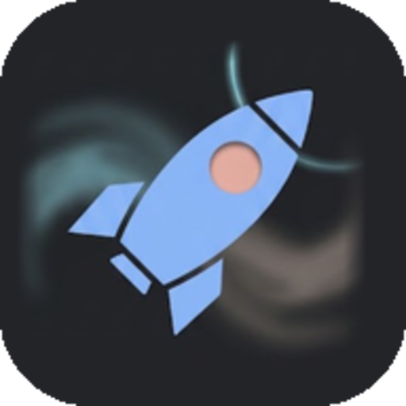

# 🚀 Lightspeed

**Um meta-launcher, camada de controle do Android e estação de trabalho.**


</div>

> **A base do Android é o Linux.**  
> Trocar de aparelho ou mudar de dispositivo Android não deveria significar perder recursos por causa de regras ou restrições artificiais impostas pela camada de software construída por cima.
>
> O Lightspeed é sobre retomar o controle e aprimorar a forma como você interage com o seu aparelho, sem obrigar você a escolher entre as implementações do Lightspeed e as da própria fabricante.
>
> O Comando Central do Lightspeed oferece um portal elegante para configurar a navegação, a interação com o hardware, montar faróis de informação e usar os controles de sistema integrados, a chamada System Override, do jeito que combina com você e com o seu Android.

<a id="download"></a>

<div align="center">

[](https://github.com/SBFlabs/Lightspeed/releases/latest)
[](https://apps.obtainium.imranr.dev/redirect?r=obtainium://app/%7B%22id%22%3A%22com.sbf.lightspeed%22%2C%22url%22%3A%22https%3A//github.com/SBFlabs/Lightspeed%22%2C%22author%22%3A%22SBF%20Labs%22%2C%22name%22%3A%22Lightspeed%22%2C%22additionalSettings%22%3A%22%7B%5C%22includePrereleases%5C%22%3A%20false%2C%20%5C%22fallbackToOlderReleases%5C%22%3A%20true%7D%22%7D)
[](https://www.youtube.com/@SBFlabs)
[](https://buymeacoffee.com/sbflabs/e/579114)

</div>

> [!TIP]
> **Download &amp; Verificação SHA-256:** Toque em **Baixar APK** acima para a última versão no GitHub, ou em **Adicionar ao Obtainium** para importar o Lightspeed já configurado com **pré-lançamentos desativados** (somente versões estáveis). Toda versão inclui um **checksum SHA-256** oficial nas notas de lançamento para verificação criptográfica.

> **Outras lojas:** Também disponível na [**ShizuStore**](https://shizustore.com/apps/lightspeed) e na [**Orion Store**](https://rookieenough.github.io/Orion-Data/redirect.html?id=lightspeed) *(o link da Orion abre dentro do app Orion Store, então o app precisa estar instalado)*.

<p align="center">
  <a href="#1-category-cruise">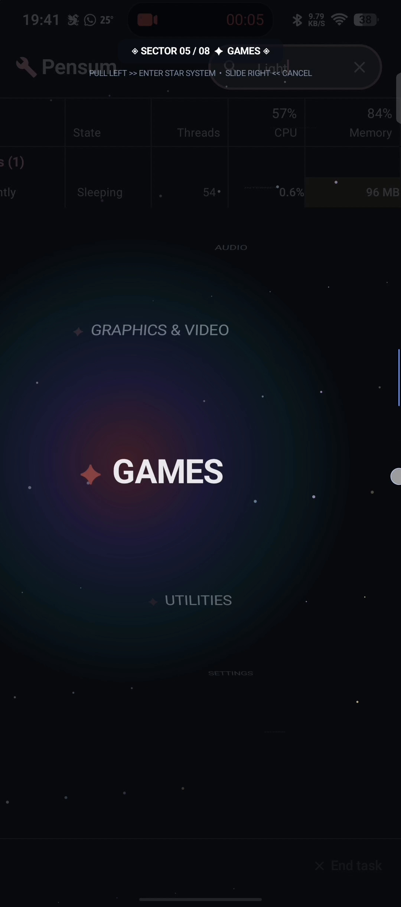</a>
  &nbsp;&nbsp;
  <a href="#2-cockpit">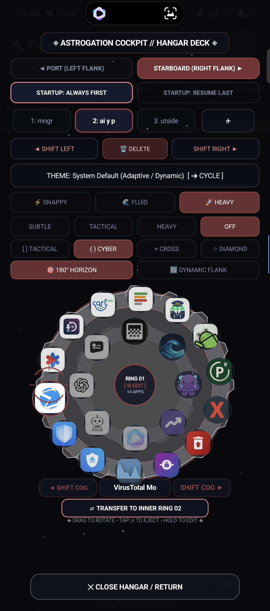</a>
  &nbsp;&nbsp;
  <a href="#3-central-command">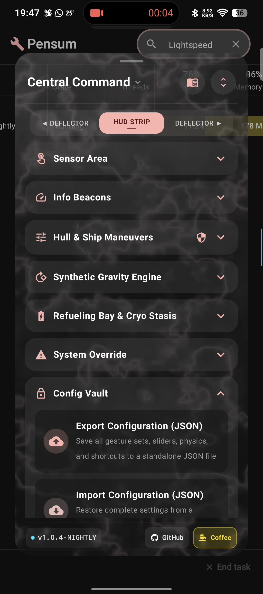</a>
</p>

<a id="index"></a>
<details>
<summary><strong>🧭 Índice (toque para expandir)</strong></summary>

- [📥 Download &amp; Verificação](#download)
- [🚀 Uma Plataforma de Lançamento, Três Estações de Trabalho](#one-launch-pad-three-workstations)
  - [🛰️ A Plataforma de Lançamento](#the-launch-pad)
  - [1. 🌌 Category Cruise](#1-category-cruise)
  - [2. ⚙️ Cockpit](#2-cockpit)
  - [3. 🛰️ Comando Central](#3-central-command)
- [📡 Áreas de Sensor de Gestos (HUD STRIP & DEFLETORES)](#gesture-sensor-areas)
  - [🪢 A Corda](#the-rope)
- [🌌 Aviônica de Voo Avançada](#advanced-flight-avionics)
  - [1. Área de Sensor](#1-sensor-area)
  - [2. Faróis de Informação](#2-info-beacons)
  - [3. Casco & Manobras da Nave](#3-hull-ship-maneuvers)
  - [4. System Overrides](#4-system-overrides)
  - [5. Cofre de Configurações](#5-config-vault)
  - [6. Laboratórios Experimentais](#6-experimental-labs)
  - [7. Decks, Trackpad, Áreas de Sensor & Master Cloak (v1.4.0)](#7-v140-highlights)
  - [8. 🆕 Idiomas, Widgets de HUD & Polimento do Dia 1 (v1.4.1)](#8-v141-highlights)
- [🔐 Permissões & Capacidades Elevadas](#permissions-elevated-capabilities)
- [⚡ Automação Externa](#external-automation)
- [🆘 Se o seu celular ficar em um estado ruim](#bad-state-recovery)
- [🛠️ Arquitetura & Aviso sobre Desenvolvimento com IA](#architecture-ai-notice)
- [💬 Comunidade, Issues & Política de Suporte](#community-support-policy)
- [💙 Modelo Gratuito & Longevidade por Apoiadores](#free-supporter-model)
- [📄 Licença & Créditos](#license-credits)

</details>

---

<a id="one-launch-pad-three-workstations"></a>
# 🚀 Uma Plataforma de Lançamento, Três Estações de Trabalho

<sup><a href="#index">[↑ Voltar ao Índice]</a></sup>

<a id="the-launch-pad"></a>
## 🛰️ A Plataforma de Lançamento

<sup><a href="#index">[↑ Voltar ao Índice]</a></sup>

A **Astrogação Central** — ou simplesmente a barra lateral — é a sua porta de entrada para as três áreas principais do Lightspeed.

<a id="1-category-cruise"></a>
### 1. 🌌 Category Cruise

<sup><a href="#index">[↑ Voltar ao Índice]</a></sup>

A gaveta de apps organizada por categorias.

Para navegar pelas categorias, mova o dedo para cima e para baixo na **Astrogação Central**. Para navegar dentro de uma categoria específica, deslize na horizontal enquanto ela estiver em foco, sem tirar o dedo da tela.

Sua posição dentro da **Category Cruise**, ou o item em foco dentro da categoria escolhida, é calculada em relação a onde o seu dedo está nas dimensões da sua tela. Não importa de onde você pretende fazer o salto para a **Category Cruise** ou de volta dela, será sempre fácil navegar por toda a gaveta de apps com o polegar, sem levantá-lo.

Para cancelar o gesto a qualquer momento, deslize o dedo de volta para a **Astrogação Central** ou para a borda da tela.

No topo da Category Cruise fica um **HUD Deck** personalizável (até 3 slots em linha ou em pilha deslizável) com o **Inspetor do App em Foco**, **Tempo de Tela & Linha do Tempo Horária de 24h**, **Sinais Vitais do Sistema & Caçador de Tarefas** (subvisões `BATTERY`, `SYSTEM`, `VITALS` e `CHART` com um gerenciador de tarefas de CPU/wakelock integrado `[HUNT ▸]` e histórico de `1H`–`30D`), **Alertas & Firewall de Toasts** e um **Slot de Widget de App Android** interativo. A partir da v1.4.1, os widgets de HUD também incluem **medidores de progresso de Tempo de Tela** (com uma lista de **Apps Ignorados**) e uma contagem regressiva do **Próximo Evento do Calendário**, estritamente opcional e 100% offline.

<br>

<p align="center">
  
</p>

<p align="center"><sub>🌠 <em>Category Cruise — navegação cinética de apps com grade de ícones ao vivo</em></sub></p>

<br>

<p align="center">
  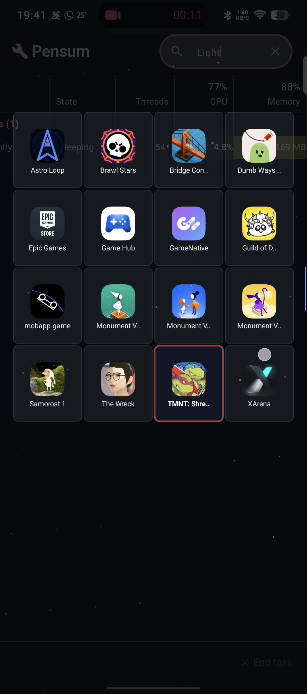
</p>

<p align="center"><sub>🌠 <em>Category Cruise — navegação no 2º salto</em></sub></p>

<br>

<p align="center">
  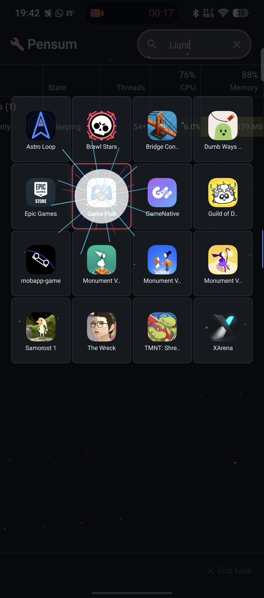
</p>

<p align="center"><sub>🌠 <em>Category Cruise — abrindo um app</em></sub></p>

<a id="2-cockpit"></a>
### 2. ⚙️ Cockpit

<sup><a href="#index">[↑ Voltar ao Índice]</a></sup>

Um espaço de trabalho configurável construído em torno dos **Conjuntos de Engrenagens do Cockpit** e do **Menu de Seleção de Ações**.

Cada Conjunto de Engrenagens contém duas engrenagens, com um **Hangar do Cockpit** giratório no centro, representado por uma mira rotativa. Uma mira fixa separada permanece sem girar, travada no item atualmente em foco.

O **Menu de Seleção de Ações** é a interface global de seleção do Lightspeed para escolher a que gestos, manobras de hardware ou itens do Conjunto de Engrenagens cada coisa corresponde.

No topo há um acordeão dedicado às **Ações de Sistema**, incluindo ações que usam o Shizuku, como fechar um app de forma limpa e voltar ao app anterior. Ele também oferece atalhos diretos para o **Vigia do Perímetro** e o **Vigia do Núcleo**.

Abaixo, os apps usados com frequência podem ser fixados no topo para acesso mais fácil. Por exemplo, **MacroDroid, Tasker, Key Mapper e Shortcut Maker** vêm fixados por padrão se estiverem instalados. Qualquer acordeão de app pode ser fixado ou desafixado com um toque longo.

Para cada app, o Lightspeed tenta oferecer seus atalhos de app, atalhos do launcher da tela inicial e atividades profundas disponíveis. Um app pode ser aberto diretamente tocando no título ou no ícone do acordeão, ou o acordeão pode ser expandido para escolher entre as opções mencionadas.

O Menu de Seleção de Ações também traz a versão característica do Lightspeed de uma barra de rolagem indexada. Dá para interagir tocando no índice ou deslizando sobre ele. Enquanto você usa a barra de índice, um HUD exibe as duas primeiras letras correspondentes à posição alfabética atual, deixando claro onde você está na lista de apps.

<br>

<p align="center">
  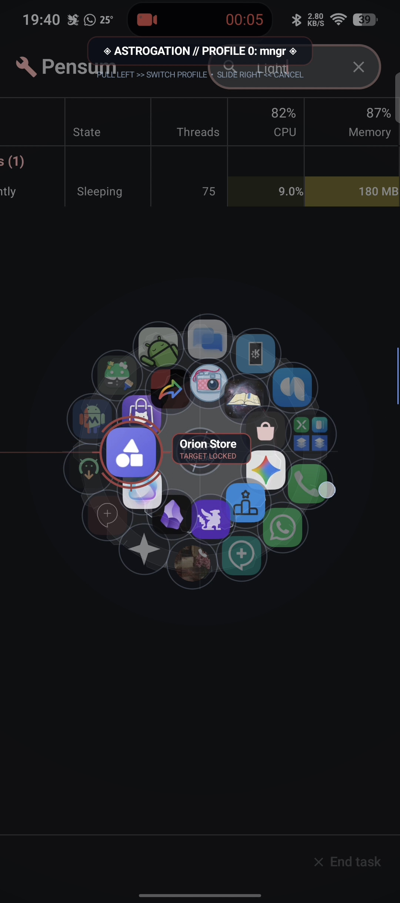
</p>

<p align="center"><sub>⚙️ <em>Conjuntos de Engrenagens do Cockpit (itens favoritos)</em></sub></p>

<br>

<p align="center">
  
</p>

<p align="center"><sub>⚙️ <em>Hangar do Cockpit — dois anéis orbitais de engrenagens com controles táteis completos de ejetar, girar &amp; editar</em></sub></p>

<br>

<p align="center">
  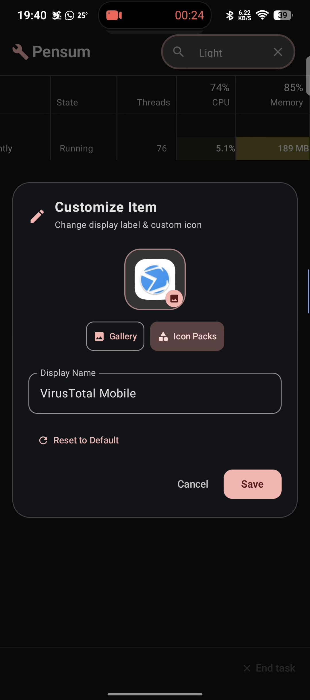
</p>

<p align="center"><sub>⚙️ <em>Hangar do Cockpit — editando itens do hangar</em></sub></p>

<a id="3-central-command"></a>
### 3. 🛰️ Comando Central

<sup><a href="#index">[↑ Voltar ao Índice]</a></sup>

O Comando Central pode ser acessado diretamente tocando no **ícone do app Lightspeed**, ou a partir da **Astrogação Central**. Enquanto você navega pelas categorias deslizando para baixo na Astrogação Central, o Comando Central fica escondido atrás da última categoria. Deslize um pouco mais para baixo para revelá-lo, acompanhado de uma sutil **resposta tátil**.

<br>

<p align="center">
  
</p>

<p align="center"><sub>🛰️ <em>Comando Central — HUD Strip, Área de Sensor, Casco &amp; Manobras da Nave, System Override &amp; Cofre de Configurações</em></sub></p>

<br>

<p align="center">
  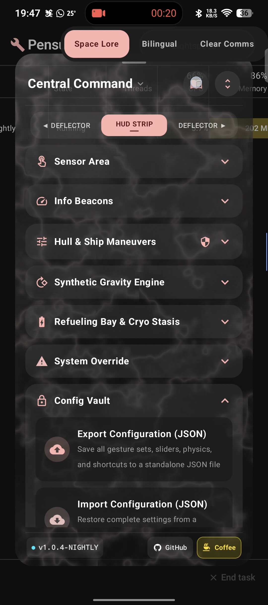
</p>

<p align="center"><sub>🛰️ <em>Comando Central — configurações de idioma</em></sub></p>

A **área do cabeçalho da janela flutuante do Comando Central** é interativa de três formas. Você pode deslizar para baixo no cabeçalho para dispensar a janela flutuante. O **título do Comando Central** pode receber um toque simples ou longo: um toque longo liga ou desliga rapidamente todo o sistema Lightspeed. O **ícone do Guia** também pode receber um toque simples ou longo. Há ainda o bom e velho botão **Expandir/Recolher Tudo** para expandir ou recolher os acordeões da aba atual.

Para personalizar o **tema do Comando Central**, toque no título do Comando Central. Para organizar ou mudar como os acordeões estão dispostos dentro de uma aba específica, toque no **título da aba enquanto ela estiver em foco** — seja a **HUD STRIP, o DEFLETOR Esquerdo ou o DEFLETOR Direito**.

O **Deck de Controle de Voo** é organizado em três cartões. O primeiro cartão contém o **motor de temas** mencionado acima para o Comando Central e diferentes formas de ligar o Lightspeed por inteiro ou em parte.

<br>

<p align="center">
  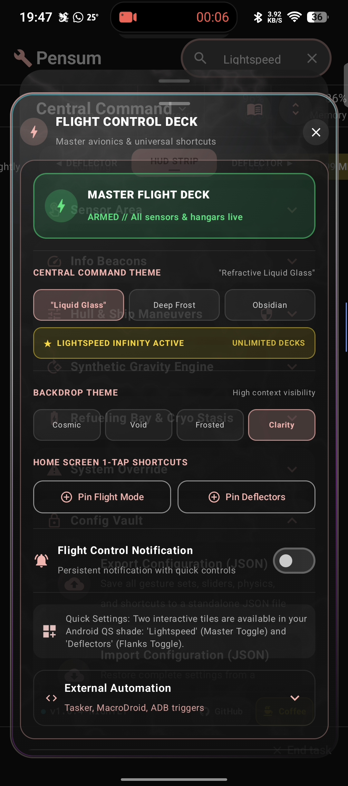
</p>

<p align="center"><sub>🛰️ <em>Deck de Controle de Voo — visão geral</em></sub></p>

<br>

<p align="center">
  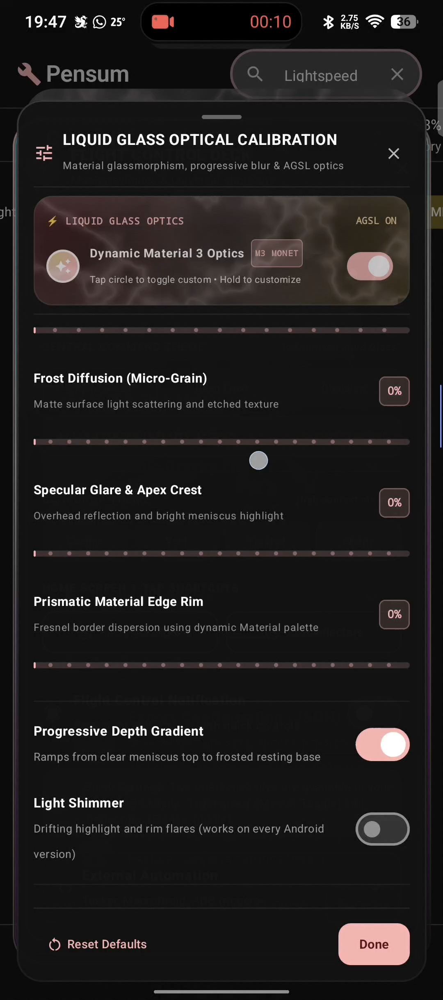
</p>

<p align="center"><sub>🛰️ <em>Deck de Controle de Voo — seleção de tema</em></sub></p>

O segundo cartão contém o **Vigia do Núcleo**. Ele mantém o Lightspeed vivo por dois métodos possíveis e inclui a **Caixa-Preta**:

1. **Revivificação Automática** — quando o Lightspeed trava, ele dispara uma mensagem de revivificação automática usando o Shizuku. **Ativada por padrão.**
2. **Verificação Periódica** — a cada 20 segundos, ele verifica se o Lightspeed ainda está vivo e operacional.
3. **Caixa-Preta** — guarda um registro leve da última falha ou erro de ação do Lightspeed, que pode ser copiado e colado em issues do GitHub para facilitar a resolução de problemas.

O **Vigia do Núcleo** também contém um **mini-cartão/botão Material 3 chamado “Serviços”.** Ao tocá-lo, abre-se o **Vigia do Perímetro**, onde os serviços de acessibilidade dos seus apps podem ser ligados e desligados com mais conveniência do que na página de configurações nativa do Android. Cada serviço também pode ser **blindado** e ter sua isenção de bateria colocada na lista de permissões ou revogada por dois botões dedicados logo abaixo dele.

<br>

<p align="center">
  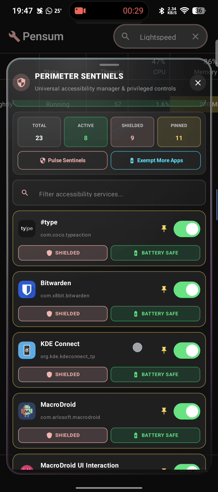
</p>

<p align="center"><sub>🛰️ <em>Vigia do Perímetro — monitoramento de serviços de acessibilidade</em></sub></p>

O **Vigia do Perímetro** também contém um **mini-cartão/botão Material 3 azul-claro chamado “Isentar Mais Apps”.** Ao tocá-lo, abre-se a **janela flutuante Isentar Mais Apps**, uma forma mais acessível de colocar apps na lista de permissões ou revogá-los do sistema nativo de isenção do gerenciamento de bateria do Android.

<br>

<p align="center">
  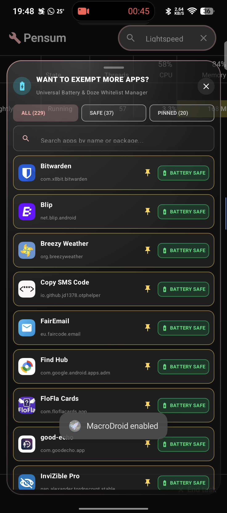
</p>

<p align="center"><sub>🛰️ <em>Isentar Mais Apps — controle de isenção de bateria</em></sub></p>

**Nem o Vigia do Núcleo nem o Vigia do Perímetro são 100% à prova de falhas e devem ser tratados como tal.**

Também existem **Ações de Sistema** dedicadas para abrir diretamente a janela do **Vigia do Perímetro** e o cartão do **Vigia do Núcleo**. Por padrão, elas ficam atribuídas aos **deslizes para a esquerda e para a direita da área de sensor da HUD STRIP**, respectivamente, dando acesso rápido sem precisar navegar pelo Comando Central.

O **terceiro cartão** oferece outra forma de ligar o Lightspeed por inteiro ou em parte.

---

<a id="gesture-sensor-areas"></a>
## 📡 Áreas de Sensor de Gestos (HUD STRIP & DEFLETORES)

<sup><a href="#index">[↑ Voltar ao Índice]</a></sup>

A aba **HUD STRIP** contém o acordeão **Área de Sensor** para a área de gestos da barra de status. As abas **DEFLETOR Esquerdo** e **DEFLETOR Direito** contêm as configurações das bordas esquerda e direita da tela, respectivamente. São áreas de sensor para os gestos que você faz ao longo das bordas da tela.

Há muita personalização e bastante coisa para explorar aqui, especialmente com o **Menu de Seleção de Ações**.

<a id="the-rope"></a>
### 🪢 A Corda

<sup><a href="#index">[↑ Voltar ao Índice]</a></sup>

Cada DEFLETOR tem um acordeão **Defletores Unificados**, refletindo como cada lado da tela pode ser tratado como uma única área de gestos ou como dois controles separados.

Dentro dele, a **Matriz de Gestos Unificada** contém uma entrada para cada gesto. Cada entrada de gesto tem a sua própria **Corda**. Quando a Corda está amarrada, aquele gesto é configurado como um único controle nas partes superior e inferior do DEFLETOR.

Toque na Corda para soltá-la. A entrada do gesto é então duplicada em entradas separadas **superior** e **inferior**, que passam para o subacordeão **Controles Separados do DEFLETOR**. A partir daí, cada metade pode ser configurada de forma independente — por exemplo, usando o gesto de **tocar e segurar** superior para controlar o brilho e o inferior para controlar o volume.

Pressionar e segurar a Corda envia o mapeamento de gesto atual para o DEFLETOR oposto. É simplesmente uma operação única de copiar e colar — não um espelhamento ou sincronização permanente.

---

<a id="advanced-flight-avionics"></a>
## 🌌 Aviônica de Voo Avançada

<sup><a href="#index">[↑ Voltar ao Índice]</a></sup>

A **HUD STRIP** vem com um conjunto de acordeões configuráveis para controles de voo adicionais, informações e ferramentas de sistema. A disposição padrão é:

<a id="1-sensor-area"></a>
### 1. Área de Sensor

<sup><a href="#index">[↑ Voltar ao Índice]</a></sup>

A **Área de Sensor** é a área de gestos da barra de status descrita acima. Seus gestos são totalmente personalizáveis pelo **Menu de Seleção de Ações**.

<a id="2-info-beacons"></a>
### 2. Faróis de Informação

<sup><a href="#index">[↑ Voltar ao Índice]</a></sup>

Os **Faróis de Informação** permitem direcionar a telemetria para o **Trilho do Horizonte**, a **Cápsula Orbital** ou ambos.

O **Trilho do Horizonte** é uma linha de progresso para downloads e para a mídia em reprodução. Mostra duas linhas por padrão e pode ser ajustado de uma a três linhas. Também pode exibir o nome da mídia em reprodução, o que pode ser especialmente útil em tablets e outras telas maiores, onde o centro da barra de status oferece mais espaço. **O Trilho do Horizonte vem desativado por padrão.**

A **Cápsula Orbital** é uma implementação leve de uma cápsula interativa ao redor do furo da câmera. Oferece vários recursos interativos, mas seu desenvolvimento foi deliberadamente despriorizado, já que muitos aparelhos Android hoje trazem suas próprias implementações. Continua disponível para experimentação e pode receber mais desenvolvimento no futuro. **A Cápsula Orbital vem desativada por padrão, e suas próprias configurações ficam nos Laboratórios Experimentais.**

<a id="3-hull-ship-maneuvers"></a>
### 3. Casco & Manobras da Nave

<sup><a href="#index">[↑ Voltar ao Índice]</a></sup>

**Casco & Manobras da Nave** oferece a **Matriz das Teclas de Volume** e os mapeamentos dos **Sensores de Toque no Casco** (toque traseiro).

Também inclui salvaguardas pensadas para preservar as funções nativas dos botões de volume e de energia do Android, incluindo gestos específicos de fabricantes, como capturas de tela e atalhos de serviços de acessibilidade. Esses comportamentos variam entre fabricantes e skins do Android — por exemplo, Samsung e Infinix XOS implementam seus atalhos de acessibilidade de formas diferentes.

**Consumo de bateria do Toque Traseiro:** o Toque Traseiro só mantém um wake lock de CPU quando seu escopo está em *Tela Desligada* ou *Sempre* (ambos marcados como Alto Consumo). Com *Somente Tela Ligada* (o padrão), nenhum wake lock é usado. O wake lock tem um limite de tempo de segurança e é desativado automaticamente com 20% de bateria ou no economizador de bateria.

<a id="4-system-overrides"></a>
### 4. System Overrides

<sup><a href="#index">[↑ Voltar ao Índice]</a></sup>

Os **System Overrides** contêm a **Soberania de Gestos de Borda Nativos**, que pode neutralizar os gestos de borda nativos do Android para que os **DEFLETORES** tenham controle total sobre essas áreas de gestos.

Também oferecem controles de **Velocidade de Animação**, **Métricas de Tela (DPI)** e **Escala da Fonte**. Esses três controles deslizantes exigem o Shizuku. Sem ele, ficam desativados e o Lightspeed mostra um banner "Shizuku offline".

Por serem configurações nativas do sistema Android comumente associadas às Opções do Desenvolvedor, o Lightspeed trata esses controles deslizantes com cautela. Tocar diretamente na trilha do controle para pular para um valor vem desativado por padrão. Pressione e segure a caixa de valor para revelar a mini janela **Controle de Precisão & Predefinições**, que contém a chave **Tocar para Pular na Trilha**. Ela pode então ser ativada quando você quiser.

Os controles deslizantes também permitem ajuste fino. Mover o dedo pelo controle normalmente segue os passos padrão, mais largos. Mover o dedo na vertical enquanto arrasta na horizontal torna o ajuste mais fino.

Tocar na própria caixa de valor restaura aquela configuração ao seu valor padrão.

<a id="5-config-vault"></a>
### 5. Cofre de Configurações

<sup><a href="#index">[↑ Voltar ao Índice]</a></sup>

O **Cofre de Configurações** contém os controles de backup, exportação e restauração de fábrica do Lightspeed, permitindo preservar, exportar ou restaurar a configuração aos valores padrão.

<a id="6-experimental-labs"></a>
### 6. Laboratórios Experimentais

<sup><a href="#index">[↑ Voltar ao Índice]</a></sup>

Os **Laboratórios Experimentais** contêm recursos que vêm **desativados por padrão** e devem ser usados a critério do próprio usuário.

Isso inclui recursos experimentais como a **Cápsula Orbital**, a **Baía de Reabastecimento**, o **Remapeamento do Botão de Energia**, o **Cronograma de Resfriamento do Núcleo** e o **Dock de Áudio Onisciente**.

A **Baía de Reabastecimento** é uma tela de dock de carregamento funcional, pensada para mostrar a velocidade de carregamento e, ao mesmo tempo, dar a você um espaço dedicado para seus widgets favoritos. Ela também exibe o relógio e oferece duas orientações de widgets, cada uma com sua própria disposição. Pode ser especialmente útil como tela de carregamento aberta manualmente — por exemplo, mostrando a velocidade de carregamento junto de um calendário e widgets de tarefas.

Como a Baía de Reabastecimento atualmente escurece a tela com uma sobreposição escura, em vez de desligar fisicamente a tela após um tempo limite, ela **não é recomendada para telas OLED**. Por isso fica nos Laboratórios Experimentais. Se quiser usá-la, abra-a manualmente ou atribua um gesto a ela pelo **Menu de Seleção de Ações → Ações de Sistema → Manutenção da Nave**.

O **Remapeamento do Botão de Energia** executa a ação atribuída sem tentar bloquear o comportamento nativo do botão de energia do aparelho.

Os demais recursos experimentais estão inacabados ou atualmente não funcionam, e é melhor tratá-los como tal.

Recursos experimentais são melhor tratados exatamente como isso: experimentos. O **gesto de deslizar para baixo da HUD STRIP** pode exigir deixar a Área de Sensor mais espessa e manter a distância do deslize para baixo aproximadamente igual à sua espessura, para que o gesto nativo de puxar a barra de status do Android não seja acionado sem querer.

<a id="7-v140-highlights"></a>
### 7. Decks, Trackpad, Áreas de Sensor & Master Cloak (v1.4.0)

<sup><a href="#index">[↑ Voltar ao Índice]</a></sup>

- **Motor de Cores de 3 Modos (`12-Theme`, `Material 3`, `Hybrid`)**: Escolha entre os modos de cor 12-Theme, Material 3 (Papel de Parede Dinâmico) e Hybrid de forma independente na Category Cruise (na aba de edição do HUD), nos Conjuntos de Engrenagens do Cockpit, no Trackpad Cibernético & Cursor e em cada HUD de Scrubber individual (Brilho, Volume, Tempo Limite de Tela, Busca de Mídia, Scrub de Rolagem), com um modo universal travado **Segure para Aplicar em Todos** (`HOLD ↗`).
- **HUD Deck da Category Cruise & Caçador de Tarefas de Vitals**: HUD modular de 3 slots (`Inspetor do App em Foco`, `Tempo de Tela & Linha do Tempo Horária de 24h`, `Sinais Vitais do Sistema` com subvisões `BATTERY` / `SYSTEM` / `VITALS` / `CHART`, `Alertas & Firewall de Toasts` e `Slot de Widget de App`) com um **Caçador de Tarefas de Vitals** integrado (`[HUNT ▸]`) para inspecionar e forçar a parada de culpados de CPU/wakelock em segundo plano, separação entre RAM residente e zRAM Swap fria, e gráficos de histórico de `1H`–`30D`.
- **13 Estilos de HUD de Scrubber & HUDs de Assinatura de Ação**: Seletor de estilos de HUD por categoria (`HUD de Assinatura de Ação`, `HUDs Minimalistas Modernos`, `HUDs Orbitais Circulares`, `HUDs Retangulares & de Barra`, mais o `Cartão Interativo de Scrubber de Linha do Tempo`) com pré-visualização ao vivo por toque longo (`HOLD ↗`) e desfoque 1:1 da captura de tela do hardware.
- **Trackpad Cibernético**: Navegação por cursor flutuante com aceleração e háptica personalizáveis, botões de macro de braço robótico e geometria de chassi refinada (incluindo o estilo **Glass**). Os modos de repetição de macro (`1x`, `2x`, `5x`, `∞ Loop`) no Editor de Macros do Bot estão totalmente liberados para todos os usuários, com transferência contínua do cursor entre os dois flancos e cancelamento de emergência por qualquer tecla de hardware.
- **Bloco de Configurações Rápidas Master Cloak**: O único bloco de Configurações Rápidas do Lightspeed. Toque para ocultar ou rearmar tudo; toque longo para escolher outros serviços de acessibilidade a desligar junto com ele. A checklist expandida de 8 itens permite parar/reiniciar o `Shizuku-Next` e o `Shevery` (com suporte a token de autenticação), pausar o Watchdog do Shizuku-Next, suspender o loopback de áudio do Sonic Deck e, opcionalmente, redefinir a Taxa de Atualização Overdrive enquanto oculto, para um stealth sem conflitos com apps bancários.
- **Vista Deck**: Brilho, óptica de tela e telemetria de hardware unificados, com 4 acordeões recolhíveis (`Brightness and Beyond`, `Optics & Eye Care`, `Astrogation Airlock & 20-20-20` e `Overdrive Hz & Telemetry HUD`). Inclui alvo de taxa de atualização adaptável ao hardware (piso `Adaptive` liberando vídeo de 10–24Hz vs. pico de Hz `Locked`, mais desbloqueio de 144Hz em Transsion/XOS) e um micro-visor arrastável por app `FPS · CPU · TEMP · RAM · BAT · WATT`. Integrado ao Domínio de Comando 12-Theme, com reordenação interativa por wireframe Blueprint.
- **Deck Sônico**: Mixer de volume por app, roteamento de hardware multicanal e isolamento de voz neural & abafador de fundo, com predefinições acústicas e perfis de usuário personalizáveis. Integrado ao Domínio de Comando 12-Theme, com reordenação interativa por wireframe Blueprint.
- **Área de Sensor Inferior**: Zona secundária de gestos de borda espelhada na borda inferior, com extensão, espessura, deslocamento, sensibilidade, brilho de repouso furtivo e matriz completa de ações de gestos configuráveis.
- **Circle to Search / Screen Assist**: Mapeamento direto de gesto para acionar o Circle to Search do Google ou a ferramenta de contexto de tela / Assistente padrão.
- **Eclusa de Astrogação & Seletores de Apps-Alvo**: A pausa consciente de 5 segundos mostra tanto o Tempo do App quanto o Tempo do Setor (tempo total hoje na categoria daquele app), e ambos os seletores de apps-alvo incluem um acordeão-resumo recolhível no topo `▸ APPS SELECIONADOS (N)` e um trilho interativo de rolagem rápida alfabética `A–Z`.

<a id="8-v141-highlights"></a>
### 8. 🆕 Idiomas, Widgets de HUD & Polimento do Dia 1 (v1.4.1)

<sup><a href="#index">[↑ Voltar ao Índice]</a></sup>

- **Multi-idioma (`EN`, `PT-BR`, `ES`)**: O Lightspeed é distribuído em inglês, português do Brasil e espanhol latino-americano neutro. Na primeira abertura, o idioma do aparelho é detectado automaticamente; depois disso, sua escolha salva é restaurada (inclusive a partir de uma importação do Cofre de Configurações). A troca é 100% offline e instantânea — sem reiniciar, sem downloads.
- **Modo Bilíngue do Mundo Real**: Escolha um idioma Primário e um Secundário e o Lightspeed mostra ambos nos títulos principais, cabeçalhos de acordeão e cabeçalhos de seção (nunca em botões compactos, chips ou controles deslizantes). Combina com os modos de vocabulário, incluindo um pareamento de vocabulário distinto **Lore + Simples** (termos do Lore Espacial com esclarecimento em linguagem simples).
- **Alternador de Guia em 2 Eixos**: Pressione e segure o **ícone do Guia** e depois arraste na **horizontal** para o modo de vocabulário ou na **vertical** para o idioma do mundo real (Bilíngue, `EN`, `PT`, `ES`). Os idiomas aparecem como selos de código neutros, sem bandeiras. Um controle deslizante de idioma correspondente e um editor do par Primário / Secundário ficam no topo do Guia.
- **Widgets de HUD da Category Cruise**: Medidores de progresso de **Tempo de Tela** com uma lista de **Apps Ignorados**, **Bateria & Sistema**, **Privacidade** e um slot interativo de Widget de App. A contagem regressiva do **Próximo Evento do Calendário** é estritamente opcional e 100% offline: ela lê o calendário do seu aparelho somente depois de você conceder `READ_CALENDAR`, e você pode escolher Todos, Trabalho, Pessoal ou calendários individuais.
- **Explicações de Sinais Vitais / Caçador de Culpados**: Explicações integradas ajudam você a ler as visões `BATTERY`, `SYSTEM`, `VITALS` e `CHART` e a usar `[HUNT ▸]` para encontrar os culpados de CPU/wakelock que drenam sua bateria.
- **Experiência Polida no Dia 1**: Controles Material 3, padrões de desfoque Hybrid, **HUDs de Assinatura** como estilo padrão em todo scrubber (Volume, Brilho, Tempo Limite de Tela, Mídia, Rolagem) e uma configuração **Armar o Núcleo do Lightspeed** mais limpa, em dois cartões, com a ajuda extra reunida em linhas expansíveis compactas. Instalações existentes nunca são modificadas pelos novos padrões.

---

<a id="permissions-elevated-capabilities"></a>
## 🔐 Permissões & Capacidades Elevadas

<sup><a href="#index">[↑ Voltar ao Índice]</a></sup>

O Lightspeed foi projetado para funcionar como um **launcher de gestos e espaço de trabalho de overlay completo e de primeira classe usando apenas o Serviço de Acessibilidade do Android** (junto com permissões padrão concedidas pelo usuário, como **Modificar Configurações do Sistema**). A navegação principal, a **Category Cruise**, os **Conjuntos de Engrenagens do Cockpit**, a **HUD Strip**, os **Defletores**, o **Trackpad Cibernético & Macros de Bot**, o **Vista Deck** (brilho, escurecimento extra, pixels inteligentes, taxa de atualização da tela e HUD de telemetria por app), a **Eclusa de Astrogação** e os **Space Pods** funcionam sem o Shizuku.

Para usuários que querem uma integração mais profunda com o SO, o **Shizuku** atua como um multiplicador opcional para usuários avançados — e muitas chaves de sistema (como **Master Cloak**, **Cuidado com os Olhos**, **Supressão do Gesto de Voltar pela Borda** e **Auto-Rotação por Rosto**) também funcionam permanentemente sem o Shizuku em execução, se `WRITE_SECURE_SETTINGS` for concedida uma vez via ADB ou Shizuku.

### Serviço de Acessibilidade

O Serviço de Acessibilidade é a base da arquitetura de gestos e overlays do Lightspeed. Ele permite que o Lightspeed detecte gestos em toda a tela, execute ações globais de navegação (**Voltar, Início, Recentes, Notificações, Configurações Rápidas, Tela Dividida, Capturas de Tela, Tela de Bloqueio**), renderize espaços de trabalho em overlay com latência zero (**Category Cruise, Cockpit, Vista Deck, HUD de Telemetria, Trackpad Cibernético**) e mantenha a responsividade dos gestos enquanto outros aplicativos estão em primeiro plano.

### Shizuku (Multiplicador Opcional para Usuários Avançados)

O **Shizuku** é opcional, mas recomendado para usuários que querem capacidades elevadas de shell do Android sem root.

Quando ativo, o Shizuku libera recursos adicionais em nível de sistema:

- **Troca para o App Anterior** — Alterne diretamente entre aplicativos recentes sem passar pelo **menu de apps recentes** do launcher.
- **Fechador de Tarefas Gracioso** — Feche o aplicativo ativo por um mecanismo gracioso de remoção de tarefa, em vez de depender do gesto de apps recentes da fabricante. Essa distinção importa em sistemas Android muito customizados, nos quais deslizar um aplicativo para fora do menu de apps recentes pode ser interpretado como uma **parada forçada**. O Fechador de Tarefas Gracioso busca evitar esse comportamento sempre que possível, o que pode ser especialmente útil para aplicativos como o Termux, que de outra forma podem ser interrompidos pelo gerenciamento agressivo de tarefas das fabricantes. A implementação ainda **não é 100% à prova de falhas contra o encerramento de tarefas pela fabricante ou outros gerenciamentos de processos em nível de sistema**.
- **Tela Dividida & Janelas Pop-Up** — Abra aplicativos compatíveis em tela dividida ou em janelas pop-up flutuantes. Os recursos de tela dividida e pop-up são testados no Infinix XOS 16 e o comportamento pode variar por aparelho; pop-ups específicos de fabricantes não são suportados.
- **Primeira Configuração do Lightspeed** — Ajuda a ativar o Serviço de Acessibilidade do Lightspeed e a concluir sua configuração inicial sem exigir que o usuário navegue manualmente por várias telas de configurações do Android.
- **Descoberta de Apps no Menu de Seleção de Ações** — Atividades profundas e entradas de "criar atalho" são descobertas sem o Shizuku. Atalhos do launcher da tela inicial e atalhos dinâmicos de apps normalmente só são expostos pelo Android ao launcher padrão, então o Lightspeed pergunta primeiro diretamente ao Android e usa o Shizuku para preencher a lacuna.

### Permissões Concedidas pelo Usuário

A maioria das permissões do Lightspeed não exige interação adicional do usuário. As permissões que exigem ação do usuário estão principalmente ligadas a recursos específicos:

- **Modificar Configurações do Sistema** — Necessária ao usar o Lightspeed para modificar configurações como **brilho da tela** ou **tempo limite da tela**.
- **Acesso a Notificações** — Necessário ao ativar recursos dos **Faróis de Informação** que dependem de acesso a notificações, como reprodução de mídia ou progresso de downloads.
- **Ignorar Otimizações de Bateria** — Usada para a funcionalidade de gerenciamento de bateria e de vigia do Lightspeed, quando suportada.
- **Publicar Notificações** — Usada para status e controles baseados em notificação, incluindo a possibilidade de ligar/desligar os **DEFLETORES** e o Lightspeed como um todo.
- **Acesso ao Uso** — Necessário para os widgets de HUD de **Tempo de Tela** e para o Tempo do App / Tempo do Setor da Eclusa de Astrogação.
- **Calendário (`READ_CALENDAR`)** — **Estritamente opcional.** Só é solicitada se você ativar a contagem regressiva do **Próximo Evento do Calendário**. Os eventos são lidos localmente no seu aparelho e nunca saem dele.
- **Fazer Chamadas** — Solicitada para ligar diretamente para contatos por atalhos do launcher da tela inicial; se não concedida, o Lightspeed disca pelo shell do Shizuku.

### Outras Permissões

As permissões a seguir são declaradas pelo Lightspeed, mas não exigem um pedido de permissão separado ao usuário sob o tratamento normal de permissões do Android:

- **Consultar Todos os Pacotes** — Permite que o Lightspeed descubra os aplicativos instalados para a **Category Cruise**, o **Menu de Seleção de Ações** e funcionalidades relacionadas de abertura de apps.
- **Vibrar** — Fornece resposta háptica em toda a interface.
- **Internet** — **Não declarada.** O Lightspeed não tem a permissão `android.permission.INTERNET` e, portanto, não tem acesso à rede pelas APIs de rede padrão do Android.
- **Gravar Configurações Seguras** — Usada para a auto-rotação por câmera. É uma permissão protegida, então precisa ser concedida via Shizuku ou ADB.
- **Wake Lock** — Usado pelo Toque Traseiro (somente nos escopos Tela Desligada ou Sempre) e para breves despertares de tela de 3 segundos pelo Remapeamento do Botão de Energia e pela Baía de Reabastecimento.

---

<a id="external-automation"></a>
## ⚡ Automação Externa

<sup><a href="#index">[↑ Voltar ao Índice]</a></sup>

O Lightspeed suporta automação externa via intents de broadcast (Tasker, MacroDroid e apps semelhantes, via intents de broadcast).

### Configuração Opcional (Opt-In)
A automação externa vem desativada por padrão. Para permitir que apps externos e o ADB enviem comandos, ative a chave:
- **Comando Central → Laboratórios Experimentais → Permitir automação externa (Tasker, MacroDroid, ADB)**

### Ações de Broadcast Suportadas
- `com.sbf.lightspeed.action.TOGGLE_FLIGHT_MODE`
- `com.sbf.lightspeed.action.SET_FLIGHT_MODE`
- `com.sbf.lightspeed.action.TOGGLE_DEFLECTORS`
- `com.sbf.lightspeed.action.TOGGLE_LEFT_DEFLECTOR`
- `com.sbf.lightspeed.action.TOGGLE_RIGHT_DEFLECTOR`
- `com.sbf.lightspeed.action.SET_DEFLECTOR`
- `com.sbf.lightspeed.action.GRAVITY_OVERRIDE_360`
- `com.sbf.lightspeed.action.TOGGLE_AUTO_ROTATE`
- `com.sbf.lightspeed.action.RESET_GRAVITY`

---

<a id="bad-state-recovery"></a>
## 🆘 Se o seu celular ficar em um estado ruim

<sup><a href="#index">[↑ Voltar ao Índice]</a></sup>

Execute apenas os comandos das configurações que você alterou. Os de wm density e font_scale são a correção mais comum.

Esses comandos podem ser executados a partir de um computador com adb, ou pelo terminal do Shizuku, se a tela ainda estiver utilizável.

Se o Lightspeed travar ou for desinstalado enquanto overrides de sistema ativos continuarem em vigor, use o comando ADB correspondente abaixo para restaurar o seu aparelho Android à operação padrão:

### Métricas de Tela & Visuais
- **Densidade da Tela (DPI)**:
  ```bash
  adb shell wm density reset
  ```
- **Escala da Fonte**:
  ```bash
  adb shell settings put system font_scale 1.0
  ```
- **Escalas Globais de Animação**:
  ```bash
  adb shell settings put global window_animation_scale 1.0
  adb shell settings put global transition_animation_scale 1.0
  adb shell settings put global animator_duration_scale 1.0
  ```
- **Apagamento de Tela por Hardware (Energia do Painel)**:
  ```bash
  adb shell cmd display power-on 0
  ```
- **Overdrive da Taxa de Atualização & Desbloqueio de 144Hz da Transsion**:
  ```bash
  adb shell settings delete system peak_refresh_rate
  adb shell settings delete system min_refresh_rate
  adb shell settings delete system user_refresh_rate
  adb shell settings put system tran_refresh_mode 0
  adb shell device_config delete display_manager peak_refresh_rate_default
  ```

### Gestos & Latência de Toque de Entrada
- **Controle do Toque Longo no Botão de Energia**:
  ```bash
  adb shell settings delete global power_button_long_press
  ```
- **Áreas do Gesto Nativo de Voltar pela Borda**:
  ```bash
  adb shell settings put secure back_gesture_inset_scale_left 1.0
  adb shell settings put secure back_gesture_inset_scale_right 1.0
  ```
- **Tempo Limite de Toque Longo do Sistema** (padrão típico; o valor original do seu celular pode ser diferente):
  ```bash
  adb shell settings put secure long_press_timeout 400
  ```

### Orientação do Sistema & Auto-Rotação
- **Auto-Rotação Geral**:
  ```bash
  adb shell settings put system accelerometer_rotation 1
  ```
- **Ângulo de Rotação Fixo do Usuário**:
  ```bash
  adb shell settings put system user_rotation 0
  ```
- **Auto-Rotação Orientada por Rosto**:
  ```bash
  adb shell settings put secure camera_autorotate 0
  ```

### Tempo Limite de Tela, Brilho & Janelas Flutuantes
- **Tempo Limite para Desligar a Tela** (padrão típico; o valor original do seu celular pode ser diferente):
  ```bash
  adb shell settings put system screen_off_timeout 60000
  ```
- **Brilho da Tela & Modo Automático** (padrão típico; o valor original do seu celular pode ser diferente):
  ```bash
  adb shell settings put system screen_brightness 128
  adb shell settings put system screen_brightness_mode 1
  ```
- **Suporte a Janelas Flutuantes (Freeform)** (padrão típico; o valor original do seu celular pode ser diferente):
  ```bash
  adb shell settings put global enable_freeform_support 0
  adb shell settings put global force_resizable_activities 0
  ```

### Acessibilidade, Energia & Soberania de Foco de Apps
- **Opções do Desenvolvedor & Depuração USB / Sem Fio (Master Cloak)**:
  ```bash
  adb shell settings put global development_settings_enabled 1
  adb shell settings put global adb_enabled 1
  ```
- **Constantes do Economizador de Bateria (Ajustador de Resfriamento do Núcleo)**:
  ```bash
  adb shell settings delete global battery_saver_constants
  ```
- **Modo Não Perturbe (Deck Sônico)**:
  ```bash
  adb shell settings put global zen_mode 0
  ```
- **Lista de Apps Zero-Sound de Hardware da Transsion**:
  ```bash
  adb shell settings delete global audio.zerosound.applist
  ```
- **AppOps de Áudio sem Redução de Volume (por pacote `<pkg>`)**:
  ```bash
  adb shell cmd appops set <pkg> TAKE_AUDIO_FOCUS default
  adb shell cmd appops set <pkg> CONTROL_AUDIO default
  adb shell cmd appops set <pkg> CONTROL_AUDIO_PARTIAL default
  adb shell dumpsys deviceidle whitelist -<pkg>
  ```

---

<a id="architecture-ai-notice"></a>
## 🛠️ Arquitetura & Aviso sobre Desenvolvimento com IA

<sup><a href="#index">[↑ Voltar ao Índice]</a></sup>

O Lightspeed é construído como um aplicativo Android modular, com seu sistema de gestos, interface de configuração, mapeamento de ações, vigias e recursos experimentais separados em componentes distintos.

O projeto passa por ciclos regulares de implementação, testes e refatoração. Como parte desse processo, arquivos-fonte com mais de **400 linhas** e **750 linhas** são usados como detectores de fumaça. Eles sinalizam componentes que podem estar acumulando responsabilidades demais e os colocam na lista do próximo ciclo de refatoração. Não são limites rígidos, e o tamanho sozinho nunca decide uma divisão: as responsabilidades que um arquivo carrega é que decidem se e como ele será dividido.

### Desenvolvimento Assistido por IA

O Lightspeed foi desenvolvido com assistência substancial de ferramentas modernas de IA. Isso é documentado aqui deliberadamente, por transparência.

Diferentes modelos são usados em diferentes partes do processo de desenvolvimento:

- **Gemini Argon 4** e **Claude Sonnet 4.6/5.5** — usados principalmente para **planos de refatoração, planejamento de recursos e planejamento de arquitetura**, ajudando a analisar a estrutura do projeto e a determinar como mudanças maiores devem ser abordadas.
- **Gemini Flash 3.6 a 3.8** e **Gemini Hydrogen** — usados principalmente para **execução**, incluindo implementar recursos planejados, modificar código e realizar tarefas de desenvolvimento com base na direção arquitetural. Também são frequentemente usados sozinhos para **pequenas correções de bugs e implementações diretas de recursos** que não exigem os modelos de planejamento maiores.
- **Gemini Pro 3.1** — usado ocasionalmente, e em geral como alternativa, para **planejamento de recursos, planos de refatoração e planejamento de arquitetura** quando a cota do modelo de planejamento principal não está disponível ou foi esgotada.

Isso não pretende sugerir que a IA projetou ou desenvolveu o Lightspeed de forma independente. A arquitetura, os requisitos, as prioridades, as decisões de teste e a direção final continuam sendo conduzidos pelo criador do projeto.

O criador não necessariamente se considera um desenvolvedor tradicional. O Lightspeed nasceu de um **sonho, uma necessidade e uma lacuna percebida na comunidade Android**: uma ferramenta de código disponível que pudesse oferecer uma abordagem diferente para gestos em todo o sistema, navegação, personalização e automação do Android.

A IA tornou possível transformar essa ideia em um projeto funcional, ao mesmo tempo em que tornou o processo de aprender, experimentar, refatorar e iterar consideravelmente mais acessível.

O uso de IA é, portanto, parte da história de desenvolvimento do projeto, não algo que esteja sendo escondido ou apresentado como experiência convencional de desenvolvimento de software. O código-fonte resultante continua sendo a autoridade final sobre o que o Lightspeed realmente faz, e os testes em aparelhos reais continuam essenciais — particularmente para o comportamento de acessibilidade do Android, implementações de sistema específicas de fabricantes, gerenciamento de bateria, tratamento de tarefas e outras áreas em que o comportamento pode variar bastante entre aparelhos.

O projeto continua passando por ciclos regulares de refatoração à medida que recursos são adicionados e a base de código evolui. A intenção não é simplesmente fazer o Lightspeed funcionar, mas manter sua implementação compreensível e fácil de manter conforme ele cresce.

### Aparelhos Testados

**Frota Principal de Testes** (testes diários em aparelhos reais a cada atualização):

- **Infinix Note 50s 5G+ (Global)** — uma fabricante chinesa de linha intermediária altamente modificada, com gerenciamento de bateria agressivo. Dimensity 7300 Ultimate, 8 GB de RAM, Android 16.
- **Samsung Galaxy A24** — um aparelho intermediário com One UI 8.5. Helio G99, 6 GB de RAM, Android 16.
- **Lenovo Tab One (também conhecido como Lenovo Tab K9)** — um tablet de entrada, quase stock. Helio G85, 4 GB de RAM, Android 15.
- **TCL NXTPAPER 11 Plus** — um tablet econômico ou de linha intermediária básica, quase stock. Helio G100, 8 GB de RAM, Android 15.

**Aparelhos com Testes Leves / de Fumaça** (instalação e gestos principais verificados; não testados a cada build diária):

- **Huawei Nova 3i** — aparelho legado com **EMUI 9** (Android 9).
- **Tecno Spark Go 1** — aparelho de entrada de **32 bits** (`armeabi-v7a`) com Android 14.

---

<a id="community-support-policy"></a>
## 💬 Comunidade, Issues & Política de Suporte

<sup><a href="#index">[↑ Voltar ao Índice]</a></sup>

Por causa de uma profissão offline exigente, **não há suporte por chat em tempo real (Discord/Telegram). A discussão oficial acontece no [XDA Forums](https://xdaforums.com/t/4804419/) (com publicações secundárias da comunidade no Reddit & YouTube); comentários/DMs no Reddit não são monitorados para triagem técnica contínua.**

Toda a comunicação, o relato de bugs e o acompanhamento de regressões são tratados estritamente de forma assíncrona via **GitHub Issues**:
- Acompanhamento de **bugs reproduzíveis e casos de borda de hardware**.
- Detecção de **regressões** em distribuições Android de diferentes fabricantes.
- Envio de logs de falha capturados pelo registrador de falhas integrado no Comando Central.

Sugestões de recursos serão catalogadas no backlog de desenvolvimento para implantação em marcos futuros, e não para lançamento imediato.

---

<a id="free-supporter-model"></a>
## 💙 Modelo Gratuito & Longevidade por Apoiadores

<sup><a href="#index">[↑ Voltar ao Índice]</a></sup>

[](https://buymeacoffee.com/sbflabs/e/579114)

A grande maioria do Lightspeed é e continuará sendo gratuita para sempre. A navegação principal por gestos, a abertura de apps, os defletores, os overrides de sistema e a confiabilidade dos backups não têm nenhum paywall.

O nível **Lightspeed Infinity** é um desbloqueio único de **US$ 1,99** no [Buy Me a Coffee](https://buymeacoffee.com/sbflabs/e/579114) (que também aceita **Google Pay**), pensado como um incentivo voluntário de agradecimento aos apoiadores. Funciona por meio de uma **chave offline sem servidor**: sem contas, sem servidores e sem verificações de rede. Apoiadores do Buy Me a Coffee também recebem um código gratuito do Google Play se/quando o Lightspeed for lançado lá. Cada dólar ajuda muito no desenvolvimento, na manutenção e no suporte da comunidade no **GitHub & XDA Forums** (além de Reddit & YouTube) — ao mesmo tempo em que desbloqueia vantagens cosméticas, temas de cockpit exclusivos, colimadores de mira personalizados e Conjuntos de Engrenagens do Cockpit ilimitados (usuários gratuitos têm 2; 3 dos 13 temas ópticos são gratuitos e os outros 10 exigem o Infinity). Se o Lightspeed ajuda no seu fluxo de trabalho, dar uma estrela no repositório e compartilhar/votar nas publicações originais no XDA, Reddit ou YouTube ajuda tanto quanto.

---

<a id="license-credits"></a>
## 📄 Licença & Créditos

<sup><a href="#index">[↑ Voltar ao Índice]</a></sup>

- **Licença**: Código disponível para uso pessoal e não comercial. Veja [LICENSE](LICENSE).
- **Créditos & Inspirações**: Agradecimentos detalhados a inspirações de terceiros, ao espírito da comunidade open source e os avisos obrigatórios (incluindo a API do Shizuku, MIT) podem ser encontrados em [CREDITS.md](CREDITS.md).
